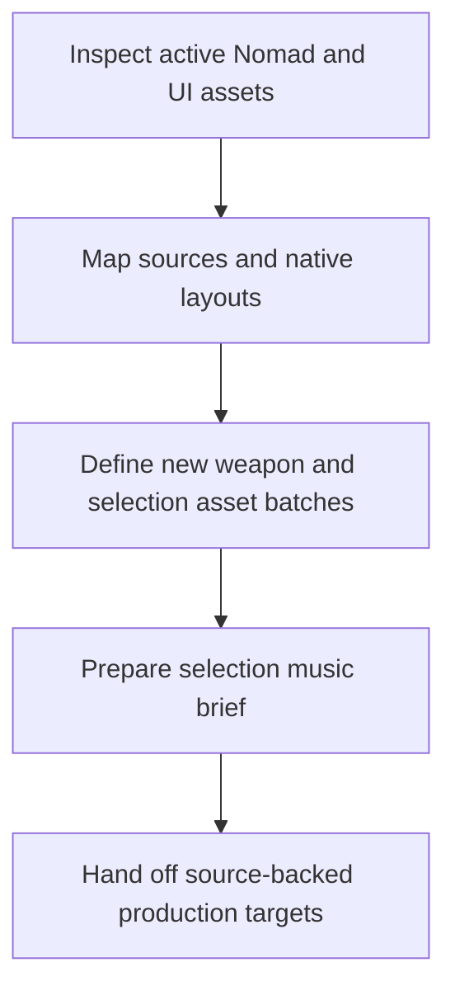
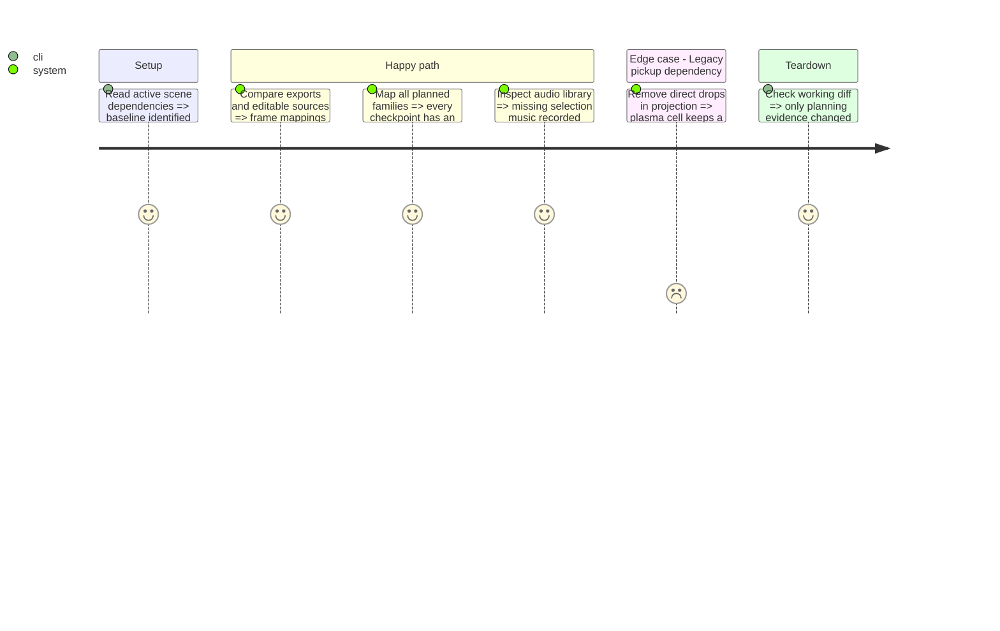

# Instruction: Ground the art and audio production contract

Completed 2026-10-20. See [verified inventory](art_audio_inventory.md), [audio handoff](selection_audio_brief.md) and [inspection evidence](../../../../docs/phase_3_validation.md). Asset/runtime inspection was read-only; only documentation changed. No commit was requested or made.

## Architecture projection

```txt
aidd_docs/tasks/2026_10/2026_10_19_phase_3_survival_builds/
  contract.md                         modify only for an evidenced explicit revision
  art_audio_inventory.md              create verified active assets and production targets
  selection_audio_brief.md            create maintainer file checklist and technical integration brief
docs/
  sprite_production_inventory.md      modify with verified Phase 3 asset mappings
  sound_design_plan.md                modify the local selection-audio scope only
  phase_3_validation.md               create actual step evidence and open production dependencies
```

## User Journey



## Test Scope



## Tasks to do

### `1)` Verify active sources and assign asset batches

> Establish a concrete native-scale production inventory without producing or rewiring assets yet.

1. Read active cannon, side-shot, beam, shield, plasma-cell and UI dependencies. Record runtime path, editable source, grid/tags, pivots, visible/collision footprint, ownership colors and destination checkpoint.
2. Retain the existing primary 5x2 atlas (16x8 cells), side 5x2 atlas (6x8 cells), and beam layout unless a measured integration need requires an explicit contract revision. The animation_rework library is not automatically active; record any reuse mapping explicitly.
3. Inventory foundation laser refresh, XP low/high-value silhouettes, dedicated plasma-cell sprite, sixteen icons and card/HUD components. Map the eight offensive families to their own feature steps using contract.md.
4. Use native 640x400 and Lost Warden 64, readable red/blue ownership and source/export pairs. Do not revive historical x4 production assumptions or change gameplay collisions as an art shortcut.

### `2)` Prepare the local selection audio brief

> Make the requested musical moment producible without expanding the global audio workstream.

1. Record the maintainer's ownership of all music and sound effects. Provide a short file checklist: a level-up sting (suggested 0.5-0.8 s), optional selection loop (suggested 20-30 s before boundary editing), navigation cue, confirmation cue and return accent. Source/master files and intended loop points are useful when available; no generation prompts or Suno work are required.
2. Assign technical preparation to the agent: preserve the supplied masters, inspect formats, prepare runtime Ogg music and WAV effects as needed, check loop boundaries, match levels, import and integrate. Store source/master and export destinations in the inventory after files arrive; the maintainer approves by listening.
3. Record that no selection audio files have been supplied and the current interactive visual preview is silent. Prototype music is optional; null streams must never block choices or visual review. Existing menu cues can support later integration checks, without claiming dedicated audio is delivered.
4. Keep Music/Sounds controls, gameplay playback-position preservation and one musical session per queued-level batch in the brief. Do not implement MusicDirector or regenerate unrelated audio. All numbered runtime delivery steps remain pending during the visual-preview review.

### `3)` Record evidence and the next requested step

> Leave an implementation-ready inventory rather than speculative completed assets.

1. Create docs/phase_3_validation.md with the actual inspection evidence, runtime/source discrepancies and pending asset/listening work.
2. Run git diff --check and inspect changed paths. No game, image or audio production is part of this step.

## Test acceptance criteria

| Task | Acceptance criteria |
| --- | --- |
| 1 | Every foundation/new-offensive asset has a source/export destination and checkpoint; active and unused libraries are distinguished; plasma cell's legacy dependency has an explicit migration target. |
| 2 | The brief identifies maintainer-provided sting/loop/navigation/confirmation/return files, agent technical integration, mute behavior and listening acceptance; the silent prototype works without supplied audio and missing inputs remain identified. |
| 3 | Evidence contains facts rather than invented runtime results; only the requested step's documentation is changed. |
