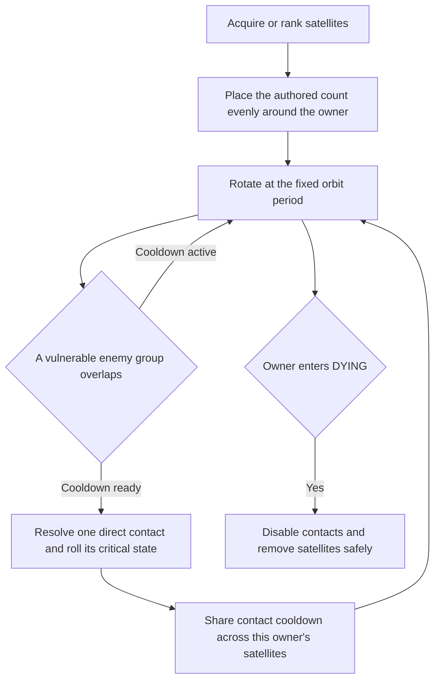
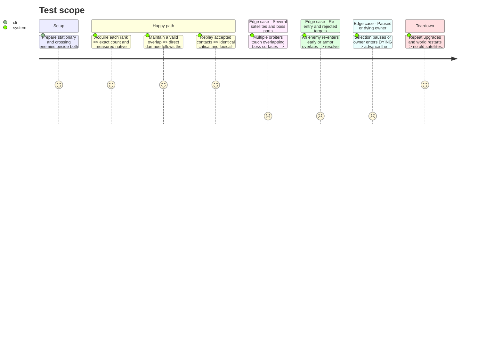

# Instruction: Add orbiting damage satellites with shared contact limits and dedicated art

## Architecture projection

> Tree of the final files. ✅ create · ✏️ modify · ❌ delete

```txt
.
├── data/upgrades/orbiting_satellites.tres                   ✅ authored counts and contact damage
├── data/upgrades/foundation_catalog.tres                   ✏️ completed-family registration
├── scenes/player/weapons/{orbiting_satellites.gd,orbiting_satellites.tscn} ✅ owned orbit/contact controller
├── scenes/player/{player_weapons,player_loadout,player_vitals}.gd ✏️ rank synchronization and death cleanup
├── scenes/combat/{combat_targeting,player_hit_snapshot,player_hit_effects}.gd ✏️ deterministic direct contacts
├── assets/sources/player/weapons/orbiting_satellites.aseprite ✅ orbiter and contact master
├── assets/sprites/player/weapons/orbiting_satellites_sheet.{png,json} ✅ matching runtime export and mapping
├── tests/player/test_orbiting_satellites.gd                 ✅ real overlaps, orbit and group cooldowns
├── aidd_docs/tasks/2026_10/2026_10_19_phase_3_survival_builds/art_audio_inventory.md ✏️ mapping and review
└── docs/phase_3_validation.md                              ✏️ append actual evidence
```

## User Journey



## Test Scope



## Tasks to do

### `1)` Implement deterministic orbit geometry and shared contact cadence

> Use the satellite counts, damage, radius, period and contact size in `contract.md`.

1. Own the satellites under one owner-attached controller, with even angular spacing and a deterministic initial phase. Preserve the current orbit phase when rank changes redistribute the count; create/remove collision objects outside physics callbacks.
2. Resolve actual overlaps in stable actor/surface order. Maintain contact cooldowns per owner and logical enemy group, shared by every satellite; delete records when their targets are no longer valid.
3. Apply DAMAGE once to direct contact damage. Apply FIRE_RATE only to the contact cooldown, preserving orbit speed; different owners keep independent cooldowns against the same target.
4. Satellite contact does not intercept projectiles, damage players or change their collision/bounds rules. Keep all collision layers named through the existing layer helper.

### `2)` Integrate direct critical state and lifecycle

> Contact ticks are bounded roots with compatible procs only when those families are later complete.

1. For each ready eligible overlap, determine whether positive damage is admissible before drawing the contact's critical result. Roll once for its accepted direct contact, then route its snapshot through the accepted-hit service; armor/inactive/destroyed targets consume no combat RNG or contact cooldown.
2. Treat all boss surfaces as one shared contact group; one satellite tick creates one root. Keep piercing and ricochet disabled; preserve future explosion/chain compatibility without exposing either unfinished family.
3. Freeze orbit and timers during pause. At DYING, disable all owned contact shapes/monitoring deferred, remove satellites safely and cancel new effects; world teardown clears contacts, cooldowns and requests.

### `3)` Deliver orbiter/contact art and validate proximity behavior

> Make the close-range build visible without implying bullet interception or a larger hit area.

1. Deliver source plus PNG/JSON for orbiter/contact states; record pivot, team mapping, angular orientation and agreement with the four-pixel contact radius in the art inventory. Keep rotation pixel-readable at native scale.
2. Test exact count/spacing, measured orbit period, continuous overlap, brief crossings, several targets, re-entry and simultaneous boss-part overlap through actual physics. Verify contact cooldown scaling, accepted-only RNG draws and independent P1/P2 behavior.
3. Inspect short native/wide sequences with hunters crossing the orbit and with satellites at playfield edges. Palette-check exports; activate the completed family, record evidence and stop before secondary-effect work.

## Test acceptance criteria

| Task | Acceptance criteria |
| ---- | ------------------- |
| 1 | Each rank has the contracted count and measured orbit/contact geometry. FIRE_RATE changes contact intervals but never rotation. Simultaneous orbiters cannot bypass a group cooldown, and separate players do not suppress each other's contacts. |
| 2 | Only accepted direct contacts draw a critical result and start cooldowns. All boss parts share one owner cooldown; satellites cannot pierce, ricochet or intercept shots. Actual pause/death callbacks produce no illegal collision removal or retained world state. |
| 3 | Source/export pairs, explicit mappings and native proximity/edge review are complete. Physics, seeded RNG and lifecycle fixtures pass with bounded cooldown records before offers include the family. |
