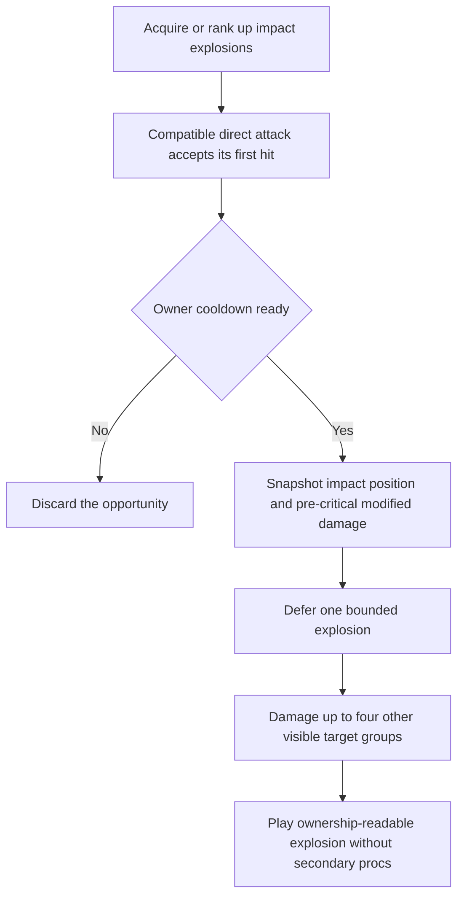
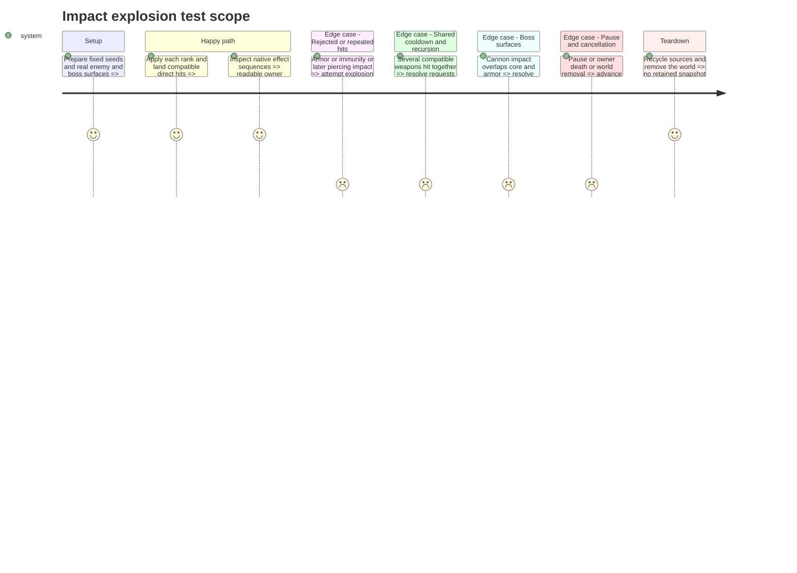

# Instruction: Add bounded impact explosions and their art

## Architecture projection

> Tree of the final files. ✅ create · ✏️ modify · ❌ delete

```txt
.
├── scenes/combat/
│   ├── player_hit_effects.gd                 ✏️
│   ├── combat_targeting.gd                  ✏️
│   ├── impact_explosion.gd                  ✅
│   └── impact_explosion.tscn                ✅
├── data/upgrades/impact_explosions.tres      ✅
├── data/upgrades/foundation_catalog.tres    ✏️ register the completed family
├── assets/sources/combat/impact_explosion.aseprite ✅
├── assets/sprites/combat/impact_explosion.png ✅
├── tests/test_impact_explosions.gd           ✅
├── aidd_docs/tasks/2026_10/2026_10_19_phase_3_survival_builds/art_audio_inventory.md ✏️
└── docs/phase_3_validation.md               ✏️ actual evidence only
```

## User Journey



## Test Scope



## Tasks to do

### `1)` Implement snapshot-driven area damage

> Add a useful crowd-clearing choice without recursive or boss-multiplying damage.

1. Depend on steps 6-10 and the locked contract. For ranks 1/2/3 use radius 20/26/32 px, damage factor 0.35/0.45/0.55 and a shared per-owner 0.30 s cooldown; FIRE_RATE does not shorten it.
2. Consume only the first accepted compatible direct impact from main/side cannons, drone bolts, missiles or satellite contacts. Read the already modified pre-critical direct base once; exclude plasma and reflected shots. Rejected hits consume no effect opportunity; cooldown-denied requests are discarded.
3. Copy position, owner, source sequence, damage and visited damage groups before deferring work. Resolve at most four other eligible groups inside radius, sorted by distance then deterministic spawn identity, with line of sight and the initial target/group excluded. Secondary damage cannot crit, pierce or trigger anything.
4. Use the existing accepted-hit entry points and common targeting helper. One external root can affect at most one visible vulnerable boss surface; a root originating on that boss cannot damage another part. Stop new procs at owner DYING; cancel deferred work on world removal.

### `2)` Deliver and validate the explosion presentation

> Ship the mechanic with its own bounded, editable visual treatment.

1. Author the source and export in Lost Warden 64 at native scale. Record grid, tags, frame offsets, duration, center pivot, rank footprint and red/blue ownership in `art_audio_inventory.md`; visual expansion must agree with the authored damage radius.
2. Pair the scene/script under `scenes/combat/`, use collision-safe deferred creation and finite visual lifetime, and keep request/VFX counts bounded by the owner cooldown. Pause freezes active effects; pooling clears owner, rank, animation and processing state. Do not retain the recycled root projectile.
3. Activate the definition only after focused tests and native sequences pass. Record actual rank, compatibility, cooldown, cap, critical-base, boss-group and lifecycle results; rerun affected direct-hit, satellite, missile and boss-part regressions. Stop for maintainer review.

## Test acceptance criteria

| Task | Acceptance criteria |
| ---- | ------------------- |
| 1 | Each rank uses its radius/factor, shares the owner cooldown across weapons, damages at most four additional visible groups and never damages the initial group twice. |
| 1 | Critical hits do not multiply splash; rejected hits create no proc/reward and secondary damage creates no recursive proc. Accepted secondary kills retain player credit and normal score/XP/plasma exactly once; plasma/reflected shots preserve their existing behavior. |
| 1 | Boss overlaps cannot turn one root hit into cannon/core splash damage; deferred work never reads a recycled projectile or survives world teardown. |
| 2 | The acquired family consumes one offensive slot, ranks reuse that slot, and the active catalog exposes only the verified mechanic. |
| 2 | Source/export mapping and native solo/co-op sequences show readable explosions with correct centers, radius and ownership; pause/reuse/death checks leave bounded objects. |
