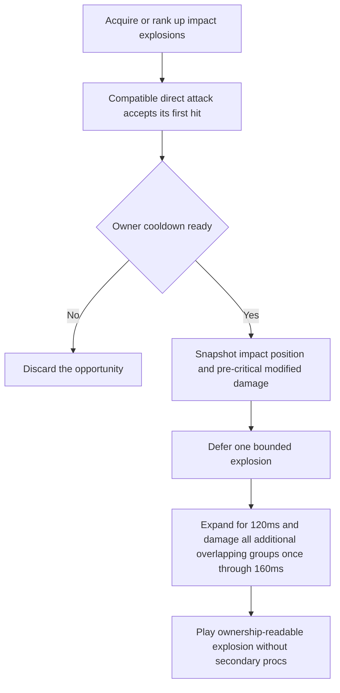
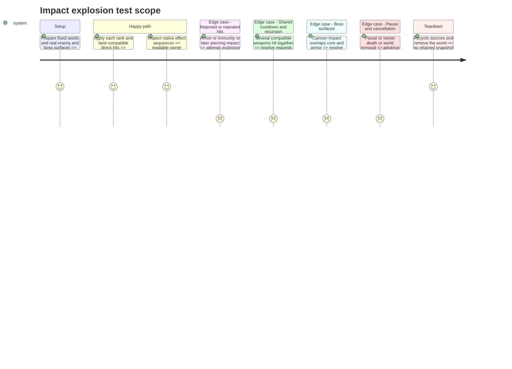

# Instruction: Add bounded impact explosions and their art

## Architecture projection

> Tree of the final files. ✅ create · ✏️ modify · ❌ delete

```txt
.
├── scenes/combat/
│   ├── player_hit_effects.gd                 ✏️
│   ├── combat_targeting.gd                  ✏️
│   ├── impact_explosion.gd                  ✅
│   └── impact_explosion.tscn                ✅
├── data/upgrades/impact_explosions.tres      ✅
├── data/upgrades/foundation_catalog.tres    ✏️ register the completed family
├── assets/sources/combat/impact_explosion.aseprite ✅
├── assets/sprites/combat/impact_explosion.png ✅
├── tests/test_impact_explosions.gd           ✅
├── aidd_docs/tasks/2026_10/2026_10_19_phase_3_survival_builds/art_audio_inventory.md ✏️
└── docs/phase_3_validation.md               ✏️ actual evidence only
```

## User Journey



## Test Scope



## Tasks to do

### `1)` Implement snapshot-driven area damage

> Add a useful crowd-clearing choice without recursive or boss-multiplying damage.

1. Depend on steps 6-10 and the locked contract. For ranks 1/2/3 use radius 24/30/36 px (final maintainer revision 2026-10-22), damage factor 0.70/0.90/1.10 and a shared per-owner 0.30 s cooldown; FIRE_RATE does not shorten it.
2. Consume only the first accepted compatible direct impact from main/side cannons, drone bolts, missiles or satellite contacts. Read the already modified pre-critical direct base once; exclude plasma and reflected shots. Rejected hits consume no effect opportunity; cooldown-denied requests are discarded.
3. Copy position, owner, source sequence, damage and visited damage groups before deferring work. Resolve every additional group whose actual hull intersects the expanding disk during its active interval, with deterministic ordering, explicit armor occlusion and the initial target/group excluded. Secondary damage cannot crit, pierce or trigger anything.
4. Use the existing accepted-hit entry points and common targeting helper. One external root can affect at most one visible vulnerable boss surface; a root originating on that boss cannot damage another part. Stop new procs at owner DYING; cancel deferred work on world removal.

### `2)` Deliver and validate the explosion presentation

> Ship the mechanic with its own bounded, editable visual treatment.

1. Author the source and export in Lost Warden 64 at native scale. Record grid, tags, frame offsets, duration, center pivot, rank footprint and red/blue ownership in `art_audio_inventory.md`; visual expansion must agree with the authored damage radius.
2. Pair the scene/script under `scenes/combat/`, use collision-safe deferred creation and finite visual lifetime, and keep request/VFX counts bounded by the owner cooldown. Pause freezes active effects; pooling clears owner, rank, animation and processing state. Do not retain the recycled root projectile.
3. Activate the definition only after focused tests and native sequences pass. Record actual rank, compatibility, cooldown, cap, critical-base, boss-group and lifecycle results; rerun affected direct-hit, satellite, missile and boss-part regressions. Stop for maintainer review.

## Test acceptance criteria

| Task | Acceptance criteria |
| ---- | ------------------- |
| 1 | Each rank uses its radius/factor, shares the owner cooldown across weapons, damages all additional groups reached during the active wave and never damages the initial group twice. |
| 1 | Critical hits do not multiply splash; rejected hits create no proc/reward and secondary damage creates no recursive proc. Accepted secondary kills retain player credit and normal score/XP/plasma exactly once; plasma/reflected shots preserve their existing behavior. |
| 1 | Boss overlaps cannot turn one root hit into cannon/core splash damage; deferred work never reads a recycled projectile or survives world teardown. |
| 2 | The acquired family consumes one offensive slot, ranks reuse that slot, and the active catalog exposes only the verified mechanic. |
| 2 | Source/export mapping and native solo/co-op sequences show readable explosions with correct centers, radius and ownership; pause/reuse/death checks leave bounded objects. |

## Delivered checkpoint — 2026-10-21

Implemented under the maintainer's instruction to proceed. See [impact explosion evidence](validation/impact_explosions.md): 145 native checks, affected regressions, exact Aseprite/export palette audits and 93 clean diagnostic documents. This checkpoint remains local for playtest; no commit or publication was requested. Stop before step 13.

### Playtest revision — 2026-10-22

The maintainer requested larger real hitboxes, percent-based cards and a durable chain fix. Completed: physics-circle hull overlap at 32/40/48px, +25%/+50% card bonuses, expanded native Aseprite art and centralized explicit source/modifier authorization. Cannons alone trigger chains; satellites no longer inherit them. Updated evidence records 168 native explosion checks, 165 native chain checks, 269 native satellite checks, clean affected regressions and 93 diagnostic documents without issues. No later roadmap step or publication was started.

### Final playtest tuning — 2026-10-22

Radius reduced by one quarter and damage doubled under the maintainer's new request. Central source rules now distinguish primary GUN from SIDE_GUN, and only primary hits trigger chains. Native explosion 171 / chain 200 / selection 48 / activation 76 checks pass, with clean diagnostics and art audits. This supersedes the preceding day's initial tuning; no later step or publication is included.

### Maintainer-approved wave correction — implemented 2026-10-22

Approved plan: repeated physics overlap for 160ms, expansion 25%-100% over 120ms, all additional hulls once, no ordinary-enemy occlusion, independent chain/blast histories with shared boss protection, one physics clock for visuals/damage and inactive fragments through 320ms. Keep the last radii/damage/cooldown; update area cards and original Aseprite animation. Completed under that scope; see [263-check wave evidence](validation/impact_explosion_wave.md). Human feel acceptance remains pending. No later step or publication was started.
