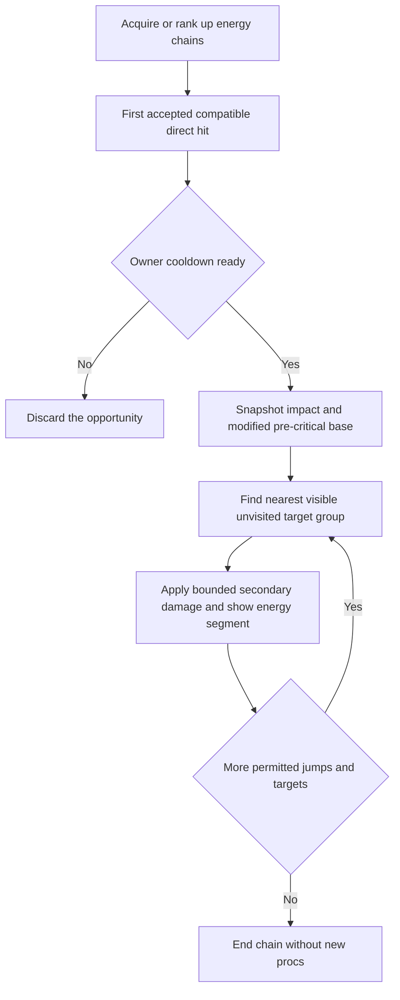
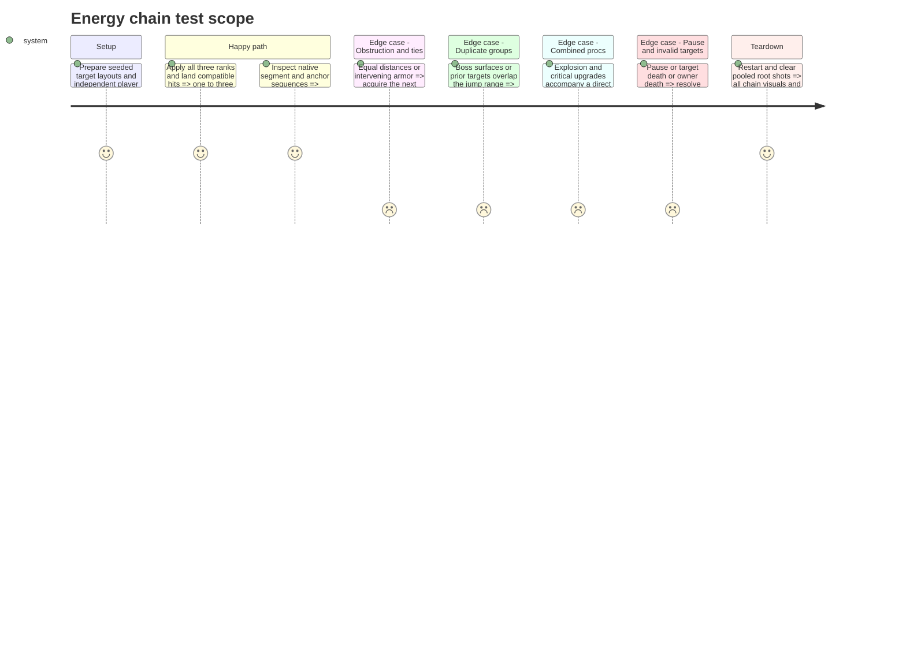

# Instruction: Add bounded energy chains and their art

Maintainer-authorized delivery-order revision, 2026-10-21: implement this family directly after the signature-beam piercing revision, ahead of micro-missiles and explosions. Existing accepted-hit/root ownership supplies the required infrastructure; step 11 is not required to deliver chains alone. Explosion coexistence remains a later combined-proc acceptance item. Keep the contract's prototype values; balance tuning is deferred by the maintainer.

Standalone scope delivered locally: [implementation and evidence](validation/energy_chains.md), **129 native chain checks**, **2,133 offer checks**, **76 native progression checks**, **42 selection checks**, **708 critical/legacy-piercing checks** and **111 beam-piercing checks PASS**. Paired editable art, runtime exports and native solo/co-op/boss presentation are verified. This status covers currently implemented weapons and critical combinations; explosion coexistence remains explicitly deferred to step 11, and later autonomous weapons must exercise chain compatibility when delivered. No commit or publication is included. Stop for review before step 8.

## Architecture projection

Movement follow-up: visual anchors now follow accepted enemy translation/recoil/rotation via weak references, freezing at their last position if removed. Pause and the original 240 ms lifetime are preserved; no targeting or damage is repeated. Latest focused native fixture: **144 checks PASS**, plus **41 accepted-hit regression checks PASS**. See the linked evidence and native movement sequence.

> Tree of the final files. ✅ create · ✏️ modify · ❌ delete

```txt
.
├── scenes/combat/
│   ├── player_hit_effects.gd                ✏️
│   ├── combat_targeting.gd                 ✏️
│   ├── energy_chain.gd                    ✅
│   └── energy_chain.tscn                  ✅
├── data/upgrades/energy_chains.tres         ✅
├── data/upgrades/foundation_catalog.tres    ✏️ register the completed family
├── assets/sources/combat/energy_chain.aseprite ✅
├── assets/sprites/combat/energy_chain.png   ✅
├── tests/test_energy_chains.gd             ✅
├── aidd_docs/tasks/2026_10/2026_10_19_phase_3_survival_builds/art_audio_inventory.md ✏️
└── docs/phase_3_validation.md              ✏️ actual evidence only
```

## User Journey



## Test Scope



## Tasks to do

### `1)` Implement deterministic non-recursive jumps

> Reward clustered targets without allowing repeated damage loops.

1. Use step 6's accepted-hit infrastructure. At ranks 1/2/3 allow 1/2/3 other targets with jump ranges 72/88/104 px. Each accepted secondary target receives 0.45 times the modified pre-critical direct base; never reapply DAMAGE. Share a 0.50 s owner cooldown across compatible weapons, unaffected by FIRE_RATE.
2. Trigger only on a compatible direct attack's first accepted impact. Main/side cannons, drone bolts, missiles and satellite contacts qualify; plasma, reflected shots and all secondary damage do not. Snapshot values and initial visited groups before deferred resolution.
3. At each jump search from the previous impact for the nearest eligible visible unvisited group, breaking ties by deterministic spawn identity. Stop when no target qualifies or the rank budget is exhausted. Keep the initial group excluded and preserve the common single-boss-group rule across every child of the root.
4. Revalidate targets before damage, use the accepted-hit API, and mark groups visited once. No chain hit can crit, pierce, explode, ricochet or launch another chain. Owner DYING stops new procs; pause freezes cooldowns and world removal invalidates queued work.

### `2)` Deliver segment and anchor art

> Make chain acquisition readable while keeping the effect finite and lightweight.

1. Deliver editable energy segment/anchor art and its runtime export in Lost Warden 64, with red/blue ownership. Record grid, tags, endpoint pivots, lifetime and export mapping in `art_audio_inventory.md`.
2. Render only the resolved finite segment list through the paired combat scene/script; no growing target search or free-running collision objects. Keep geometry aligned with actual accepted targets and clear references at expiry/teardown.
3. Test all ranks, ranges, ties, obstruction, group deduplication, critical-base calculation, combined procs and recycled-source safety. Capture native solo/co-op chains against ordinary clusters and boss parts. Activate only the verified definition, append real evidence and stop for review.

## Test acceptance criteria

| Task | Acceptance criteria |
| ---- | ------------------- |
| 1 | Ranks reach no more than 1/2/3 other targets within their jump ranges, with deterministic nearest-target ordering, line of sight and no repeated group. |
| 1 | Each hit uses the fixed pre-critical factor once; critical combinations do not recurse or multiply boss-part damage. The future chain/explosion combined-proc assertion is deferred to step 11 after the maintainer's delivery-order revision. |
| 1 | Invalid targets, owner death, pause, reuse and restart do not leak requests, change unrelated RNG streams or permit secondary proc sources. |
| 2 | Source/export mappings and native captures show finite, correctly anchored, owner-readable links; acquiring/ranking the family obeys the offensive-slot rules. |
