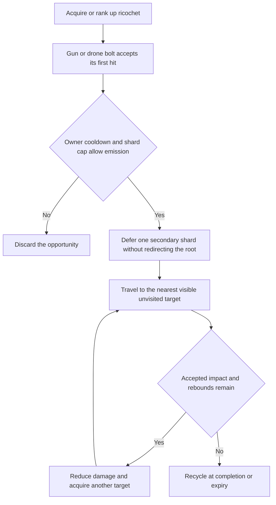
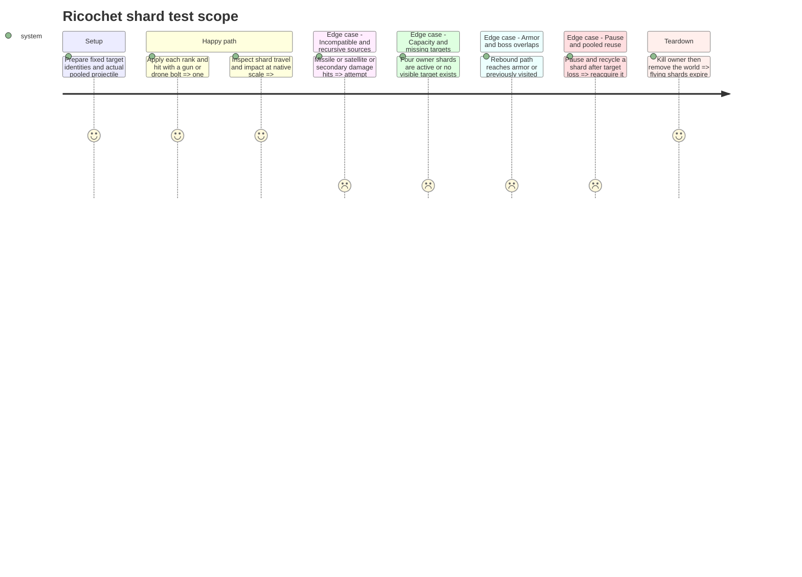

# Instruction: Add bounded ricochet shards and their art

## Architecture projection

> Tree of the final files. ✅ create · ✏️ modify · ❌ delete

```txt
.
├── scenes/combat/
│   ├── player_hit_effects.gd               ✏️
│   ├── combat_targeting.gd                ✏️
│   ├── ricochet_shard.gd                 ✅
│   ├── ricochet_shard.tscn               ✅
│   └── projectile_pool.gd                ✏️ shard reset integration
├── data/upgrades/ricochet.tres            ✅
├── data/upgrades/foundation_catalog.tres  ✏️ register the completed family
├── assets/sources/combat/ricochet_shard.aseprite ✅
├── assets/sprites/combat/ricochet_shard.png ✅
├── tests/test_ricochet_shards.gd          ✅
├── aidd_docs/tasks/2026_10/2026_10_19_phase_3_survival_builds/art_audio_inventory.md ✏️
└── docs/phase_3_validation.md             ✏️ actual evidence only
```

## User Journey



## Test Scope



## Tasks to do

### `1)` Implement a separate pooled secondary projectile

> Add propagation while preserving original shot behavior and fixed workload limits.

1. Depend on step 12. Emit one shard only from the first accepted impact of a main/side cannon or drone bolt; never redirect or recycle the original early. Missiles, satellite contacts, plasma, reflected shots and secondary hits cannot trigger ricochet.
2. Snapshot the modified pre-critical direct base and initial visited groups. Initial shard damage is 0.55 times that base; multiply by 0.8 for each subsequent accepted rebound. Ranks allow at most 1/2/3 other groups. Never reapply DAMAGE or critical multiplication.
3. Use speed 300 px/s, maximum acquisition range 88 px, lifetime 1.2 s, four active/reserved shards per owner and a 0.40 s owner cooldown unaffected by FIRE_RATE. Reserve before deferred creation; saturation discards opportunities without backlog.
4. Acquire each next target by nearest visible unvisited group and deterministic spawn tie-break. Preserve the common boss-group exclusion across root and children; armor blocks travel. If a target disappears, reacquire an eligible next target without extending lifetime or hit budget; recycle when none qualifies.
5. Route shard damage through accepted-hit handling but tag it as secondary: no crit, piercing, explosion, chain or further ricochet. Owner DYING prevents new shards; existing shards may finish their bounded lives. Pause freezes travel, lifetime and cooldowns; world removal cancels all requests.

### `2)` Deliver shard and impact art with safe reuse

> Ship a distinct visual projectile whose reset behavior is verified under physics.

1. Author shard/impact source and export using Lost Warden 64, native-scale integer placement and red/blue ownership. Record grid, tags, pivot, collision footprint and animation mapping in `art_audio_inventory.md`.
2. Pair scene/script under `scenes/combat/` and use ProjectilePool's deferred release rules. Reset owner, damage, target, lifetime, source identity, bounce count, visited groups, reservation and animations on reuse; use play after re-entering the tree.
3. Cover real collisions, repeated callbacks, target loss, expiry, simultaneous owner caps, cancellation and combined explosion/chain/critical builds. Verify original piercing shots continue independently. Capture native solo/co-op sequences; activate the definition only after focused regressions pass, append actual evidence and stop for review.

## Test acceptance criteria

| Task | Acceptance criteria |
| ---- | ------------------- |
| 1 | One eligible root impact emits at most one separate shard; original gun/drone shots retain their behavior, and incompatible sources never emit shards. |
| 1 | Rank budgets, 88 px acquisition, 1.2 s lifetime, 0.40 s cooldown and four active/reserved shards hold independently for each player without accumulated bursts. |
| 1 | Damage follows the initial 0.55 factor and subsequent 0.8 reductions once; visited groups, armor and boss surfaces cannot produce extra or recursive hits. |
| 2 | Real collision/reuse checks produce no physics-flush errors or stale owners/targets; pause, death and restart keep requests and objects bounded. |
| 2 | Editable/export mapping and native travel/impact sequences preserve collision agreement and ownership; slot/rank eligibility exposes the completed family correctly. |
