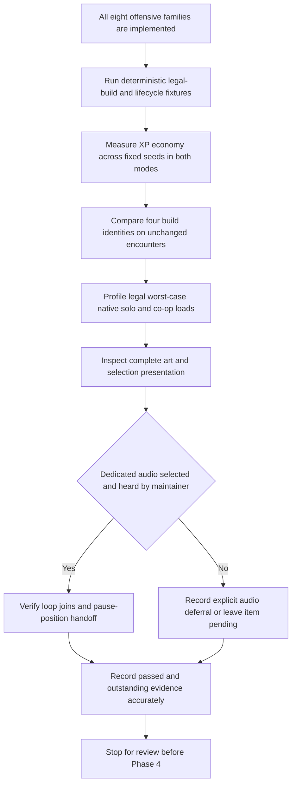
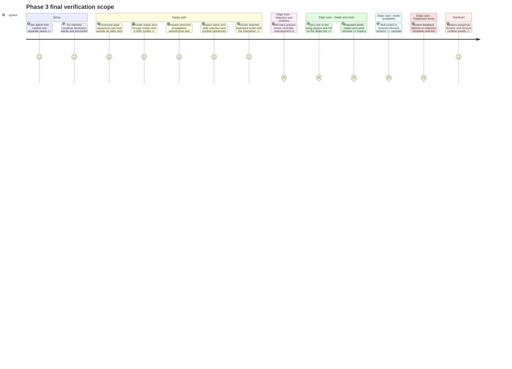

# Instruction: Validate builds, economy, performance and final presentation

## Architecture projection

> Tree of the final files. ✅ create · ✏️ modify · ❌ delete

```txt
.
├── tests/
│   ├── test_phase_3_builds.gd              ✅
│   ├── test_xp_economy.gd                 ✏️ reuse the step 5 fixture with the full catalog
│   ├── test_phase_3_lifecycle.gd           ✅
│   └── test_phase_3_presentation.gd        ✅ native capture/audio fixture
├── data/progression/progression_config.tres ✏️ only explicitly justified collection corrections
├── data/enemies/*.tres                    ✏️ XP fields only if economy measurements justify them
├── scenes/ui/upgrade_selection.gd         ✏️ only verified presentation/audio corrections
├── scenes/ui/upgrade_selection.tscn       ✏️ selected local audio integration
├── scenes/ui/upgrade_selection_audio.gd   ✏️ local pause-position and selected-asset handoff
├── assets/audio/music/level_up_selection.ogg ✅ only after selection/listening or explicitly deferred
├── assets/audio/sfx/ui/level_up_sting.wav  ✅ only after selection/listening or explicitly deferred
├── assets/audio/sfx/ui/level_up_return.wav ✅ only after selection/listening or explicitly deferred
├── aidd_docs/tasks/2026_10/2026_10_19_phase_3_survival_builds/art_audio_inventory.md ✏️
└── docs/
    ├── phase_3_validation.md              ✏️ measured results and limitations
    ├── gameplay_rework_plan.md           ✏️ verified checkpoint and next approved scope
    ├── debug_screen.md                   ✏️ implemented controls and diagnostic fields
    └── sound_design_plan.md              ✏️ local selection-audio result or explicit deferral
```

## User Journey



## Test Scope



## Tasks to do

### `1)` Verify progression and the complete compatibility surface

> Prove the full catalog works under legal builds and lifecycle boundaries.

1. Depend on steps 1-13. Enumerate all 70 four-offensive sets from eight families and sample each of the 35 three-utility sets from seven families, following the beam-piercing revision. Exercise acquired and maximum ranks, active/reserved caps, first accepted impacts, critical-base math, independent owner cooldowns and non-recursive secondary effects; test whole-boss damage groups and armor/line of sight with real collision scenes.
2. Cover shared XP, threshold overflow, queued levels, one/two/zero offers, automatic fallback, no direct drops, immutable offer/build snapshots, seeded P1-then-P2 generation, independent controller prefixes, stale/duplicate requests, and 0/1/2 eligible players including DYING plus XP in one physics tick.
3. Exercise pause menu/options/controller reassignment, F10 inspector, F11 compact view and real screen transitions during selection; retained choices never replay opening effects. Verify F1-F8 retain their actions, F9 creates only the documented legal build, N/F12 retain guards, and stat cheats cannot invalidate outstanding offers.
4. Verify run reset and legacy save loading without new persistent fields. Rerun meaningful Alpha 9, elites, primary/side fire, beam, shield, boss parts/patterns, screen-transition and progression regressions; replace obsolete rank/drop expectations explicitly rather than weakening assertions.

### `2)` Measure early progression and build identities

> Calibrate XP around the fixed encounter system and show why choices matter.

1. Run seeds 0-99 in both modes with the same documented scripted destruction/collection fixture. Record first selection, the next four intervals, emitted/collected/lost XP, mode and seed. Report medians against the 20-25 s first-choice and 35-50 s early-interval goals, separately from actual solo playtests.
2. Compare precision (side/piercing/crits/missiles), propagation (side/explosion/chain/ricochet), autonomous (missiles/drone/satellites/crits), and proximity (satellites/explosion/chain/drone) on identical seeds and encounters. Record focused-target destruction time, clustered clear time, effective coverage and exposure needed for contact effects; identify each build's useful strength and tradeoff.
3. Correct only measured XP reward/collection problems within the contract. Do not change encounter density, budgets, health or scheduling; if fixed formula/drop constraints prevent the targets, stop and request an explicit economy revision. Combat-rank or slot changes also require an explicit contract revision, not an undocumented final tuning pass.

### `3)` Verify bounded native performance and presentation

> Separate technical co-op confidence from later human balance acceptance.

1. Run a five-minute native stress fixture per mode with legal maximum builds and a scripted full boss pattern/phase/defeat/recovery cycle. On the same machine record renderer, resolution, wall-time frame p50/p95/p99, active/reserved/parked objects and requests, separately from accelerated economy projections. Verify caps for 128 orbs, three missiles, six drone bolts, one drone, three satellites and four shards per owner; cooldown-driven visual work must remain bounded. Full natural 12-minute balance runs remain in Phase 6.
2. Repeat death/restart/world-removal cycles and inspect counters for upward drift. Save diagnostics containing seed, shared XP/queue, each player's legal slots/ranks, offers, cooldowns, caps and pool counts. Debug reads and screenshots must not consume gameplay RNG.
3. Inspect real 640x400 and expanded-width solo/co-op captures and short sequences for every new effect, all icon/slot/card states, ordinary/high-value XP, dedicated plasma cells and signature beam normal/overdrive. Check Lost Warden 64 sources, export grids/tags, pivots, collision agreement, ownership and native pixel placement against the inventory.
4. Verify the selection opening timings, 300 ms input gate plus fresh release, simultaneous independent choices, 120 ms queued-card transitions and 150 ms exit. Combat clocks, plasma and proc timers stay frozen; menu/debug preserve state. Record technical co-op results; keep human co-op balance acceptance in Phase 6.

### `4)` Complete the bounded selection-audio handoff and evidence

> Finish the local presentation without starting the broader MusicDirector workstream.

1. Integrate the music and sound effects supplied by the maintainer: level-up sting, optional selection loop, navigation, confirmation and return accent. The suggested sting/loop durations remain 0.5-0.8 s and 20-30 s before boundary editing. No generation prompts or Suno work are required. Preserve supplied masters; handle technical import, loop edits, level matching, Music/Sounds routing and Ogg/WAV exports as needed. The maintainer confirms the result by listening. No files have been supplied at this planning checkpoint; the current interactive visual preview is silent and all runtime steps remain pending. Missing audio never blocks prototype choices; keep final audio acceptance pending unless explicitly deferred.
2. Verify one sting/loop session per contiguous queued-level batch, no restart for another player/level, and restrained navigation/confirmation cues. Pause the same gameplay music player and resume its playback position; honor separate Music/Sounds mute settings. Missing/muted/blocked streams never gate interaction, and exit/restart cancels local audio/tweens without disturbing navigation fades or Master volume ownership.
3. Record suite names/results, measured economy/build/performance data, native captures, listening approval or explicit deferral, and remaining limitations in validation and roadmap documentation. Update implemented debug controls and the selection-audio checkpoint. Historical enemy-feedback failures and the inspector shutdown-resource warning remain explicit baseline limits; selected passing suites do not establish a blanket repository pass.
4. Mark Phase 3 complete only when required functionality and verified presentation hold and every remaining audio item has approval or explicit deferral. Stop for maintainer review; no commit, publication, Phase 4 implementation, permanent progression or human co-op balance sign-off is implied.

## Test acceptance criteria

| Task | Acceptance criteria |
| ---- | ------------------- |
| 1 | Legal slot combinations and all compatible weapon/effect pairs preserve deterministic accepted-hit rules, caps, ownership and boss-group deduplication without recursive secondary damage. |
| 1 | Shared progression, personal snapshots/controls, overflow, queueing, overlays, guarded debug actions, death-tick ordering and restart complete without softlocks, stale requests or legacy-save changes. |
| 2 | Reproducible seed-by-seed economy metrics and solo observations are recorded; goals are met or an explicit economy revision remains outstanding without compensating enemy-pressure changes. |
| 2 | All four reference builds exhibit an observed strength and tradeoff on identical encounter data; claims of usefulness identify their measurement conditions. |
| 3 | Native measurements show bounded objects/requests and no upward lifecycle drift; frame-time percentiles and machine conditions are recorded rather than inferred from headless FPS. |
| 3 | Source/export checks and native/wide captures establish readable ownership, effects, slots/cards and preserved manual plasma identity; technical co-op evidence is distinct from deferred Phase 6 human acceptance. |
| 4 | Dedicated selection audio has maintainer listening approval or explicit recorded deferral; null/mute/Web-blocked playback never delays choice, and the gameplay track resumes without rewinding. |
| 4 | Documentation distinguishes observed passes, known baseline failures/warnings and pending human checks; no automatic commit or later-phase implementation occurs. |
