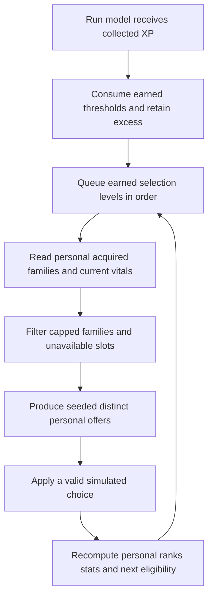
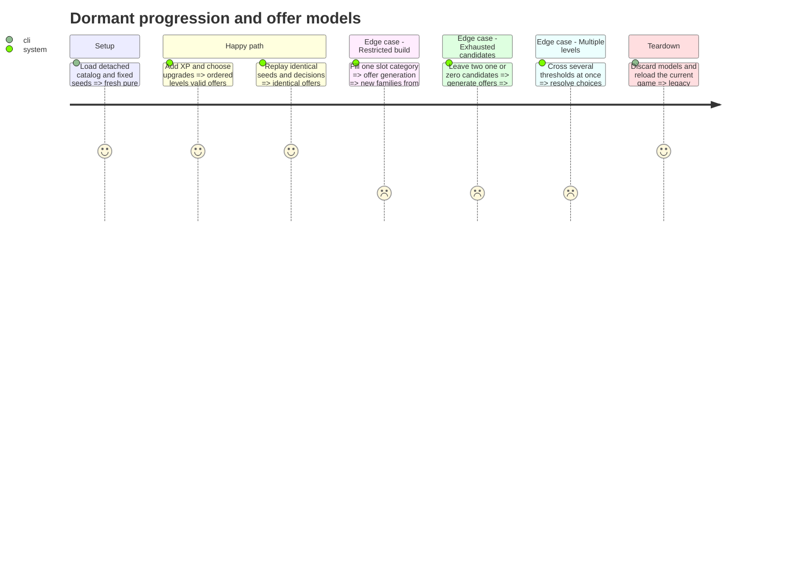

# Instruction: Build dormant progression, loadout and offer models

Completed 2026-10-20. Detached resources and pure models are implemented; ordinary gameplay still uses the legacy catalog and initialization. Godot 4.7.2 isolated validation: RunProgression 102 checks, upgrade/loadout/offers 1,853 checks, Alpha 9 161 checks, inspector 71 checks, and fire/beam/shield suites PASS. See [step 2 evidence](../../../../docs/phase_3_validation.md#step-2--dormant-progression-loadouts-and-offers). No commit was requested or made.

## Architecture projection

> Final files for this step. ✅ create · ✏️ modify · ❌ delete

```txt
.
├── data/progression/
│   ├── run_progression.gd                         ✅
│   └── progression_config.gd / .tres              ✅
├── data/upgrades/
│   ├── upgrade_definition.gd                     ✏️
│   ├── upgrade_table.gd                          ✏️
│   ├── foundation_catalog.tres                   ✅
│   └── foundation/                               ✅ foundation-only resources
├── scenes/player/player_loadout.gd               ✏️ additive dormant interfaces
└── tests/
    ├── test_run_progression.gd                   ✅
    └── test_upgrade_offers.gd                    ✅
```

The authoritative values and policies are in [contract.md](contract.md), sections **Progression and offers**, **Foundation ranks** and **Current implementation and ownership**. This step produces pure models and detached data. It does not change the active `upgrade_table.tres`, the six current upgrade resources, player-stat defaults, enemy rewards or live player initialization. No runtime feature flag is needed.

## User Journey



## Test Scope



## Tasks to do

### `1)` Author detached configuration and foundation definitions

> Give the foundation explicit data without activating it.

1. Create `ProgressionConfig` for the contract's XP threshold parameters, native foundation limits, attraction values, offer weights and slot capacities. Keep this resource detached from live player initialization until step 4.
2. Extend `UpgradeDefinition` additively with display name, description, icon, category, repeatable status and authored rank values. Preserve existing enum ordinals; append new effects. Preserve the meaning/defaults of fields still used by direct pickups.
3. Create foundation-only definitions and `foundation_catalog.tres` for the contract's foundation families and repeatable/fallback rewards. Do not add unimplemented offensive effects to the active candidate set. Icons may remain unassigned until step 4 art delivery.
4. Add catalog validation for unique stable IDs, coherent categories/ranks and positive offer weights. Keep the existing single-pick API's behavior unchanged.

### `2)` Implement pure shared XP and personal build state

> Keep progression independent of scenes, the event bus and saved profiles.

1. Implement `RunProgression` with reset, integer XP intake, threshold consumption, remaining XP and FIFO earned selection levels. Level 1 starts empty; use the exact contract formula.
2. Extend `PlayerLoadout` with explicit foundation initialization using `ProgressionConfig`, stable-ID acquired ranks, category-slot eligibility and deterministic derived stats. Existing initialization and direct-pickup calls retain legacy behavior until step 4 switches their callers.
3. Derive foundation speed, manual delay, common direct-damage multiplier, side-shot rank values and attraction radius from authored ranks. Keep plasma reserve and current energy/shield outside permanent acquired ranks.
4. Make repair/shield eligibility depend on a supplied vital-state snapshot. Repeated consumables and score never consume family slots. Provide adapters required by current debug/HUD consumers without reordering enum values.

### `3)` Generate distinct seeded offers

> Make the contract's choice policy testable without a canvas or player node.

1. Extend `UpgradeTable` with foundation offer generation from a personal build/vitals snapshot and the existing offer RNG stream. Implement acquired/new/consumable sets, first-choice offensive/utility guarantees and the specified weights without replacement.
2. Return copied offer/build snapshots carrying stable upgrade IDs, current/next rank and authored display values. Drawing and navigation must not cause RNG consumption.
3. Handle fewer than three candidates and automatic fallback exactly as the contract specifies. Generate P1 then P2 in a fixed order before either choice can change state.
4. Test caps, all four valid utility combinations, offensive-slot limits, repeatable rewards, different personal co-op builds, reset, excess XP and deterministic traces. Confirmation validation and pause coordination belong to step 3.

## Test acceptance criteria

| Task | Acceptance criteria |
| ---- | ------------------- |
| 1 | Foundation definitions validate, enum ordinals remain stable, and loading the current game still uses its existing catalog, ranks and stats. |
| 2 | One XP grant can earn several ordered selections without losing excess; a fresh run clears progression and acquired families. |
| 2 | Rank changes derive the exact contract stats once, permanent slots cannot be replaced or exceeded, and consumables never occupy a family slot. |
| 3 | The same seed and decision sequence produce identical distinct valid offers; personal builds may produce different co-op offers. |
| 3 | First-choice and acquired/new guarantees hold when possible; one/two candidates stay one/two, and zero candidates alone grants fallback score. |
| 1-3 | Focused tests pass in the existing isolated runtime; no XP or selection system has been wired into ordinary gameplay. |
