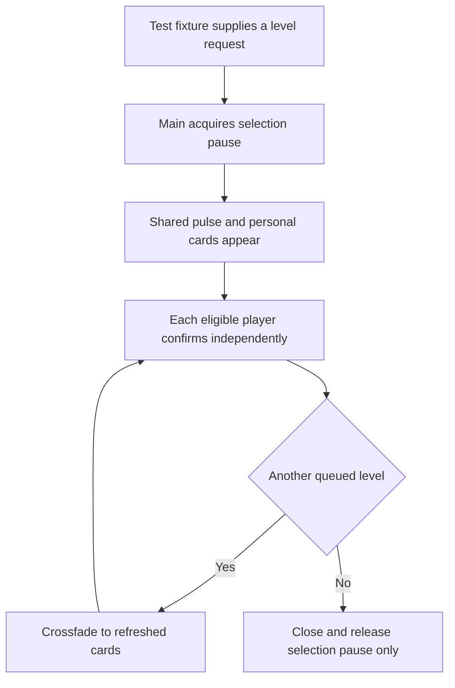
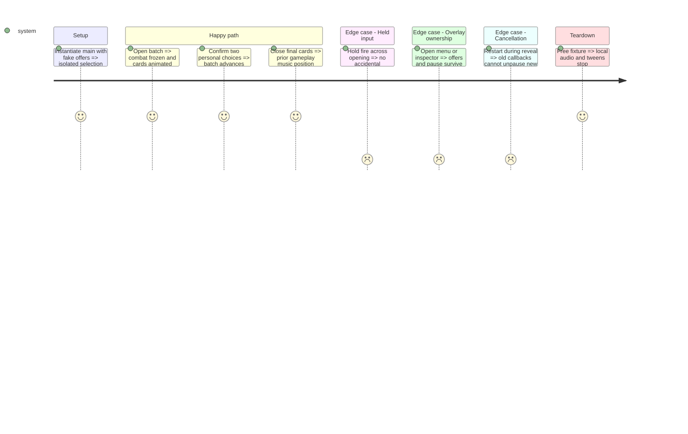

# Instruction: Compose pause ownership and the audiovisual selection screen

Verified 2026-10-20 before live activation. Selection tests: 33 headless / 39 native checks PASS; scoped audio 7 checks PASS; inspector 71 and screen-fade regressions PASS. Native 640x400 solo/co-op/opening/ready and 960x400 solo captures reviewed. UI Aseprite re-export matches all runtime pixels and Lost Warden 64. Dedicated audio remains pending. User authorization continues through step 4's first playable foundation; no commit made.

## Architecture projection

```txt
scenes/main/main.gd                         modify single pause calculation and modal input priority
scenes/ui/upgrade_selection.gd/.tscn         create always-processing selection canvas
scenes/ui/upgrade_selection_audio.gd         create local sting/loop/music-pause ownership
core/events.gd                             modify selection request, choice and completion interfaces
tests/test_upgrade_selection.gd             create personal cards, input and queued-level fixtures
tests/test_selection_presentation.gd         create opening/audio/cancellation fixtures
tests/test_debug_screen.gd                   modify pause-composition regression
tests/test_screen_fades.gd                   modify real-navigation ownership regression
assets/sources/ui/phase_3_upgrade_ui.aseprite create editable reusable selection art
assets/sprites/ui/phase_3_upgrade_ui.png      create matching export
aidd_docs/tasks/2026_10/2026_10_19_phase_3_survival_builds/art_audio_inventory.md modify mappings
docs/phase_3_validation.md                   modify actual verification evidence
```

## User Journey



## Test Scope



## Wireframe

```txt
┌──────────────────────────────────────────────────┐
│ (1) Level and shared XP                           │
├────────────────────────┬─────────────────────────┤
│ (2) Player one         │ (2) Player two           │
│ (3) OFF 1 2 3 4        │ (3) OFF 1 2 3 4          │
│     UTIL 1 2 3         │     UTIL 1 2 3           │
│ ┌────────────────────┐ │ ┌─────────────────────┐ │
│ │ (4) Offer one      │ │ │ (4) Offer one       │ │
│ ├────────────────────┤ │ ├─────────────────────┤ │
│ │ (4) Offer two      │ │ │ (4) Offer two       │ │
│ ├────────────────────┤ │ ├─────────────────────┤ │
│ │ (4) Offer three    │ │ │ (4) Offer three     │ │
│ └────────────────────┘ │ └─────────────────────┘ │
│ (5) Input and state    │ (5) Input and state     │
└────────────────────────┴─────────────────────────┘
```

1. Shared progress and queued-level context.
2. Identity of the participant.
3. Equipped family icons and ranks.
4. Icon, name, rank change and numeric effect.
5. Personal controller hint and confirmation state.

## Tasks to do

### `1)` Unify pause and selection input ownership

> Fix the existing pause race before adding a live level-up interruption.

1. Compute SceneTree.paused from transition/menu/inspector/selection flags in main. Remove unconditional resume paths that ignore another reason; retain existing screen transitions.
2. Route input in priority order: transition, inspector, menu, selection, gameplay. Preserve the configured per-player prefixes; keep two cursors and confirmation states instead of global GUI focus.
3. Allow the menu over a suspended selection for controller options; refresh bindings on return without changing offers. Block stat cheats while selection is pending.
4. Require fresh release/press after opening and each queued level. Validate selection/player/upgrade IDs and ignore echo/duplicate/stale requests. Mouse clicks address only their panel.

### `2)` Build the native choice screen and opening

> Make a level-up visibly rewarding while gameplay remains completely stopped.

1. Implement the contract's exact 640x400 layout, centered solo variant, seven slots, numeric cards and ready state. Keep English in-game text concise; reuse slkscr and existing palette/ownership.
2. Produce editable/exported card and HUD component art. Use the contract pulse/dim/reveal timing; all presentation runs in the always-processing canvas with pause-aware tweens, not frozen world effects.
3. Play one full opening for a batch, 120 ms card crossfades for later levels, and a 150 ms exit. Enable confirmation after 300 ms plus fresh input; no animation/audio completion may block progress indefinitely.
4. Accept snapshots supplied by tests only in this step; do not wire normal enemy rewards/world progression yet. Do not add a player-facing partial-progression mode.

### `3)` Integrate scoped audio and verify presentation

> Support the special selection music without changing global music architecture.

1. Localize sting/loop/cues to the selection scene. Pause/resume the same gameplay music player at its position; never invoke main._fade_to for this overlay or enable paused combat sounds.
2. Route music to Music and clicks/confirmation to Sounds. Use approved dedicated assets when available; otherwise existing UI cues and null loop are valid early fixtures. Missing/muted/blocked audio cannot delay cards or closing.
3. Keep one loop/sting per batch, including co-op and queued levels. Cancel tweens, audio and pending callbacks on real navigation/restart; maintain outer menu/debug pause ownership.
4. Run the new input/presentation suites and debug/fade regressions. Capture actual native/wide solo/co-op openings, cards and ready states; document technical checks separately from subjective audiovisual approval.

## Test acceptance criteria

| Task | Acceptance criteria |
| --- | --- |
| 1 | Closing an overlay cannot resume another owner's pause; keyboard and both gamepads select independently; held/stale inputs cannot consume levels. |
| 2 | Layout fits the native viewport, state/ranks are readable, every batch has one full opening and queued cards change without reopening; current normal gameplay still uses its original reward loop. |
| 3 | Gameplay music resumes without rewinding, paused combat audio stays stopped, mute/missing audio is safe and cancellation cannot affect a replacement world; visual evidence and open listening work are recorded. |
