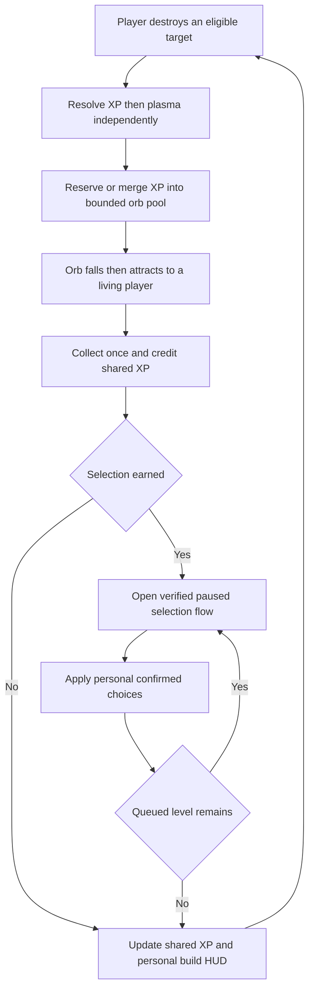
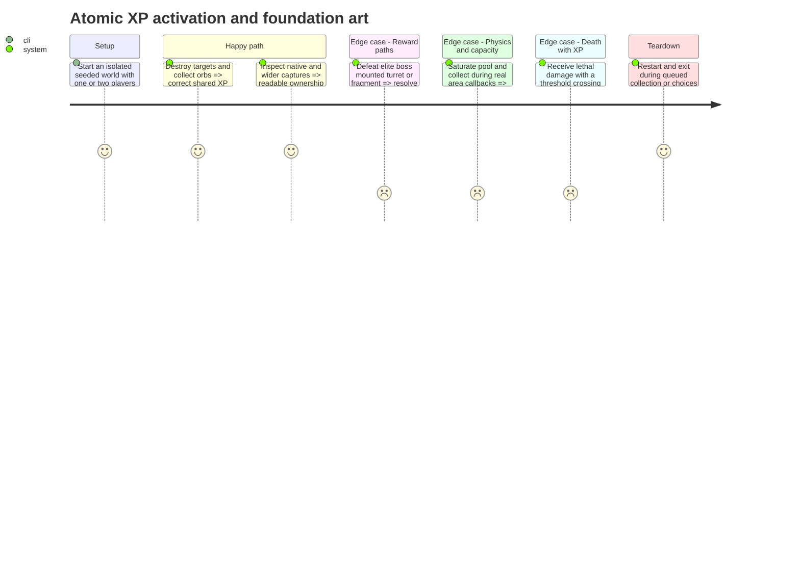

# Instruction: Activate pooled XP and the foundation as one coherent gameplay change

Completed 2026-10-20 under the maintainer's request to continue through a first playable version. XP/rewards, personal foundation builds, native HUD/selection and paired sprite sources/exports are active together. XP orbs: 20 checks; reward paths: 2,526; full activation: 65 headless / 73 native; retained regressions and native art verification documented in [phase_3_validation.md](../../../../docs/phase_3_validation.md#step-4--first-playable-foundation). Dedicated music/SFX and measured XP calibration remain pending. No commit made; later offensive families remain outside the live catalog.

## Architecture projection

> Final files for this step. ✅ create · ✏️ modify · ❌ delete

```txt
.
├── scenes/progression/
│   ├── progression_controller.gd                ✅
│   ├── xp_orb.gd / .tscn                        ✅
│   └── xp_orb_pool.gd                           ✅
├── data/enemies/enemy_definition.gd / *.tres     ✏️ XP data and fragment context
├── data/enemies/enemy_spawn_context.gd          ✏️
├── data/bosses/dread_ark_enemy.tres              ✏️
├── data/player/player_stats.gd / .tres           ✏️ atomic foundation limits
├── scenes/enemies/enemy.gd                      ✏️
├── scenes/bosses/dread_ark.gd                    ✏️
├── scenes/player/                              ✏️ player weapons shield and projectile presentation
├── scenes/world/world.gd / .tscn                ✏️ controller pool and HUD wiring
├── scenes/main/main.gd                         ✏️ atomic selection activation
├── scenes/ui/hud.gd                             ✏️
├── scenes/ui/plasma_cell.gd / .tscn              ✏️ dedicated cell presentation
├── core/events.gd                               ✏️ progression and build snapshots
├── assets/sources/{player,pickups,ui}/           ✏️/✅ editable foundation art
├── assets/sprites/{player,pickups,ui}/           ✏️/✅ runtime exports
├── docs/phase_3_validation.md                   ✏️ actual delivered evidence
├── aidd_docs/tasks/2026_10/2026_10_19_phase_3_survival_builds/
│   └── art_audio_inventory.md                  ✏️ source/export and frame mapping
└── tests/
    ├── test_xp_orbs.gd                          ✅
    ├── test_progression_activation.gd           ✅
    └── existing reward rank audio suites        ✏️ intentional migration
```

Activate steps 2 and 3 together only after both are verified. [contract.md](contract.md) is authoritative for **XP rewards and collection**, **Foundation ranks**, **Art and opening presentation** and **Verification and handoff**. Keep only the implemented foundation catalog active; later offensive groups are delivered separately.

## User Journey



## Test Scope



## Wireframe

```txt
640 x 400 fixed core; keep the tested step-3 selection layout.
LEFT RAIL (P1)            COMBAT AREA             RIGHT RAIL (P2 in co-op)
energy / shield           x104..535               energy / shield
4 offensive icon/ranks                            4 offensive icon/ranks
3 utility icon/ranks                              3 utility icon/ranks
                                                  SURVIVAL  mm:ss
                                                  LEVEL n
                                                  [shared XP / threshold]
```

The rail illustration identifies content ownership; preserve native HUD margins and keep the fixed core centered on wider viewports. The complete selection-card geometry follows the contract's prototype layout.

## Tasks to do

### `1)` Deliver the foundation visual inventory

> Supply runtime-ready art before retiring the legacy pickup presentation.

1. Refresh primary/side lasers from their editable masters; preserve the manual signature plasma normal/overdrive identity. Map source frames, tags, dimensions, pivots and runtime animations explicitly; do not assume the separate animation-rework libraries are drop-in replacements.
2. Author ordinary/high-value XP silhouettes, a dedicated plasma-cell sprite and all upgrade/reward icons; complete the seven-slot strips and shared XP bar using the reusable card/HUD components delivered in step 3. Reuse its card focus/ready states. Icons for future families remain presentation assets only until their effects ship.
3. Deliver editable sources with runtime exports using the contract palette, native scale and red/blue ownership. Update `art_audio_inventory.md` with source/export and frame/tag mappings. Verify actual stills and short sequences for collision alignment and readability.
4. Migrate `PlasmaCell` away from cell 7 of `power_up.png` before removing that runtime dependency. Retain its authored reward values and existing collection audio behavior.

### `2)` Implement bounded collision-safe XP collection

> Credit shared XP once while retaining value under pool saturation.

1. Add a world-owned XP orb pool with the contract's active-plus-reserved cap, stable reservation order and deterministic oldest-entry merge. Check capacity before deferred materialization; release reservations on cancellation.
2. Implement falling, nearest-live-player acquisition, P1 distance ties, retained targets, dead-target reacquisition, collection distance and ordinary off-screen recycling using the exact contract values.
3. Latch collection before emitting XP, disable collision and reparent deferred, ignore repeat releases and parked exit callbacks. Reset every listed reuse field. Keep orb audio outside recycled nodes.
4. Finish `ProgressionController` integration with live-player registration, safe deferred collection/selection scheduling and world lifetime cancellation. Start it explicitly after the world's run-seed reset and player registration; child-ready initialization must not consume the previous run's RNG. Reuse the verified step-3 selection coordinator rather than adding another pause owner.

### `3)` Switch every reward and foundation consumer atomically

> Remove direct random power-ups and activate consistent personal ranks in the same delivered step.

1. Add authored XP values/chances to enemy resources. Mark spawned asteroid fragments in their instance spawn context, leaving their plasma rules intact. Ordinary boss reinforcements retain ordinary rewards; separate boss surfaces award none.
2. Replace normal Enemy, elite and Dread Ark reward paths with fixed-order independent XP/plasma rolls. Reward only accepted player defeats; escapes, cleanup and retirement produce no XP. Remove all active calls capable of spawning the legacy direct-power-up scene.
3. Wire the foundation catalog/config into new runs and apply its native stat limits, side-shot outer-pair gate, common direct-damage calculation, separate plasma formula and shield cap together. Do not combine old flat bonuses with new multipliers.
4. Publish shared progression and personal seven-slot snapshots through `Events`; migrate HUD/debug adapters and choice notifications. Keep the existing F1-F8 bindings, use eligibility-aware cheats and block stat cheats during outstanding offers.
5. Replace obsolete old-drop/old-rank assertions intentionally while preserving plasma, beam, shield, fire, pooled-shot, boss-part and transition protections. Preserve save compatibility and the known baseline limitations.

### `4)` Verify the complete foundation before expanding combat

> Demonstrate a coherent first playable version, not balanced claims from unit tests.

1. Run real collision callback tests, pool saturation/conservation tests and all reward-source paths, including the boss override and fragments.
2. Exercise solo/technical co-op choices, same-tick death/XP, multiple queued levels, restart, legacy saves, overlay nesting and debug-controller changes.
3. Inspect native/wide HUD and selection captures with maximum foundation ranks. Verify collection sounds survive immediate recycling and the new plasma cell remains visually distinct from XP.
4. Record actual delivered evidence and remaining numerical calibration work in `docs/phase_3_validation.md`. Dedicated selection audio may remain explicitly pending under the contract's listening gate; never imply unapproved audio is complete.

## Test acceptance criteria

| Task | Acceptance criteria |
| ---- | ------------------- |
| 1 | Every foundation source has a verified runtime export and mapping; dedicated plasma-cell art removes its legacy atlas dependency without changing its resource behavior. |
| 2 | Actual collection callbacks grant shared XP once without physics-flush errors; active/reserved orbs remain bounded and saturation merges rather than drops granted value. |
| 2 | P1 ties, target retention, death/reacquisition, off-screen exits and pooled reuse match the contract and never reactivate stale collection state. |
| 3 | Every defeat path uses the XP table and preserved plasma behavior; no legacy direct power-up can spawn, including after an elite or boss kill. |
| 3 | Live rank limits, gun/plasma damage, side-shot gating, consumables, slots and HUD all switch together; old saves and existing debug bindings still work. |
| 4 | Solo and technical co-op can earn, resolve and resume queued selections; dying players and world teardown cannot leave stale offers or pause state. |
| 1-4 | Focused and relevant retained regressions pass, native/wide presentation evidence is reviewed, and unfinished audio/balance acceptance remains explicitly recorded. |
