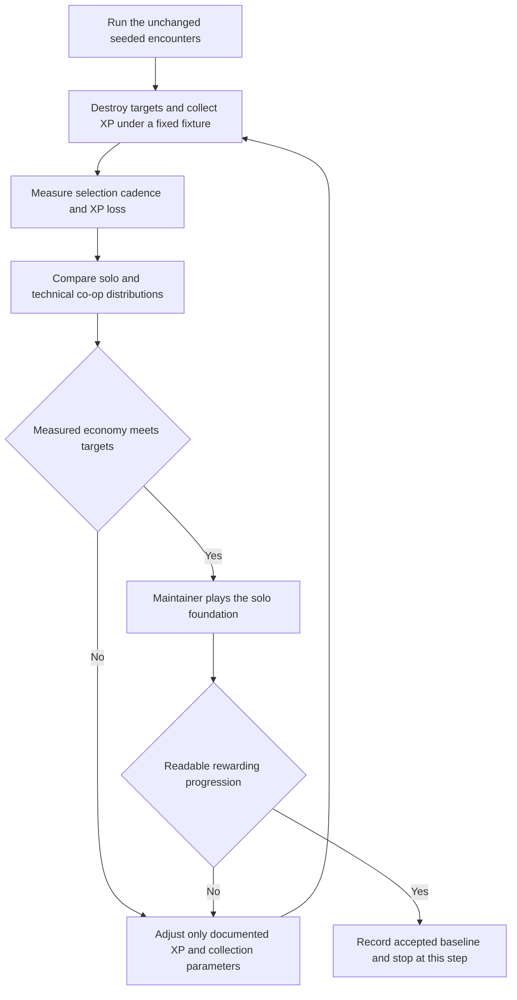
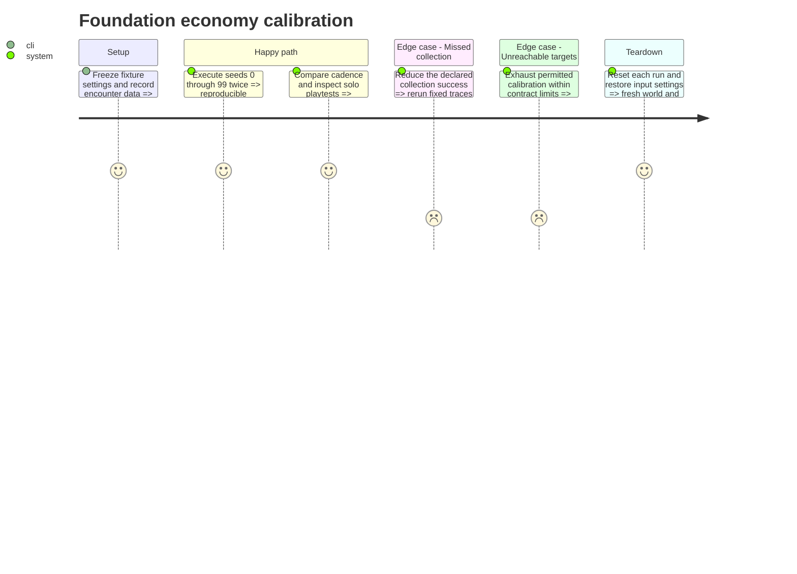

# Instruction: Measure and calibrate the foundation XP economy

## Architecture projection

> Final files for this step. ✅ create · ✏️ modify · ❌ delete

```txt
.
├── tests/test_xp_economy.gd                      ✅
├── data/progression/progression_config.tres     ✏️ only measured economy adjustments
├── data/enemies/*.tres                          ✏️ only measured XP reward adjustments
├── docs/phase_3_validation.md                   ✏️ actual results and deferred acceptance
└── aidd_docs/tasks/2026_10/2026_10_19_phase_3_survival_builds/
    ├── contract.md                             ✏️ explicit numerical revision if justified
    └── validation/step_5_economy.md             ✅ metrics and solo playtest evidence
```

Use [contract.md](contract.md), **XP rewards and collection** and **Verification and handoff**. This is foundation calibration before additional offensive families, not the final expanded-catalog balance pass. Encounter density, budgets, health, scheduling and the threshold formula remain unchanged. Human co-op balance acceptance remains deferred; co-op simulation and technical invariants are required here.

## User Journey



## Test Scope



## Tasks to do

### `1)` Establish an honest repeatable fixture

> Separate economy measurements from assumptions about real player skill.

1. Create a headless economy suite covering seeds 0-99 in both modes for the first 300 simulation seconds. Exercise the actual director/reward/progression logic with deterministic scripted destruction and collection; never replace it with a second handwritten drop formula.
2. Use an exact 1/60 virtual step, destruction one second after materialization and XP collection two seconds after orb spawn. Start fresh, stationary, invulnerable players and resolve scripted choices without advancing gameplay clocks. Run a perfect-collection upper-bound trace, then a trace where every fifth stable orb sequence misses collection, giving a deterministic 20% missed-event schedule. Preserve each missed orb's actual value when accounting for XP loss; do not imply 20% lost XP when values differ.
3. Define the fixture's personal policy as the first eligible ID in stable priority order: side_shot, damage, fire_rate, speed, orb_magnet, energy, shield. When reused with the expanded catalog in step 14, if no offered ID matches that priority, select the lexicographically first eligible offered ID. Honor the real slot rules and select automatic score fallback only when the real offer set is empty. Do not use extra offer RNG.
4. Record seed, mode, encounter trace, selection timestamps in gameplay simulation time, the next four intervals, levels reached, and emitted/collected/off-screen-lost XP. Report still-active and cancelled orb value separately so accounting closes without calling it collected or lost.
5. Stop measurement at 300 simulation seconds; report missing/censored thresholds and their count rather than excluding slow seeds. Fast-forward the virtual clocks and flush deferred batches safely; do not wait a wall-time frame for every virtual frame. Repeat the identical fixture to verify deterministic traces.
6. Label this fixture an economic projection, not evidence of player skill, physics correctness or performance. Real collision and pooling evidence belongs to step 4; real build kill-rate and full-run comparisons belong to step 14.

### `2)` Calibrate only the progression economy

> Establish a useful progression baseline without starting the enemy-density redesign.

1. Report medians and 10th/90th percentiles against the contract's first-choice and early-interval goals. Preserve per-seed outliers and compare the two collection assumptions and both modes.
2. Tune only authored XP probabilities/values and orb fall/homing/attraction parameters. Change one parameter group at a time, rerun the same seeds and record before/after results and the reason for each retained revision.
3. Keep plasma chances/amounts, weapon strengths, enemy health, encounter weights/budgets/density and scheduling fixed. Keep the threshold formula and already confirmed slot rules fixed.
4. Update the contract explicitly for any retained prototype numerical change. If allowed changes cannot achieve the targets, stop this step with the measured conflict and request an explicit economy revision; do not insert hidden XP guarantees or change enemy pressure.

### `3)` Validate the foundation in real solo play

> Confirm that the measured rhythm produces understandable choices during actual combat.

1. Prepare three seeded solo runs using the measured profile; the maintainer plays until five choices, death or five minutes, whichever comes first. Capture the first choice and early intervals, XP recovery difficulties, useful choices, selection readability and deaths. Full-run/new-build comparisons remain step 14.
2. Compare real collection/timing with the fixture assumptions. Do not describe scripted clear/collection results as observed player behavior or mark human acceptance without feedback.
3. Retain technical co-op evidence for shared XP, independent choices and partner death. Record human co-op balance acceptance as deferred rather than passed.
4. Store the fixture version, machine/runtime, seeds, final parameters, measured distribution and solo feedback in the validation note and link its actual results from `docs/phase_3_validation.md`. Stop after this requested step; expanded offensive effects and final catalog acceptance remain later work.

## Test acceptance criteria

| Task | Acceptance criteria |
| ---- | ------------------- |
| 1 | Seeds 0-99 produce repeatable traces in both modes, with declared assumptions, explicit missing observations and closed XP accounting. |
| 1 | The fixture exercises the shipped reward/progression rules, consumes no cosmetic RNG and resets run/personal state between seeds. |
| 2 | Before/after distributions expose first-choice and early-interval medians and percentiles; retained tuning is reproducible and confined to approved economy parameters. |
| 2 | Encounter pressure, health, plasma behavior, weapon power and the threshold formula remain unchanged; unattainable targets are raised explicitly rather than hidden by unrelated tuning. |
| 3 | Three real solo runs have recorded observations and maintainer feedback, distinct from simulation evidence. |
| 3 | Technical co-op invariants are covered, human co-op balance remains visibly deferred, and the next offensive group has not started automatically. |
