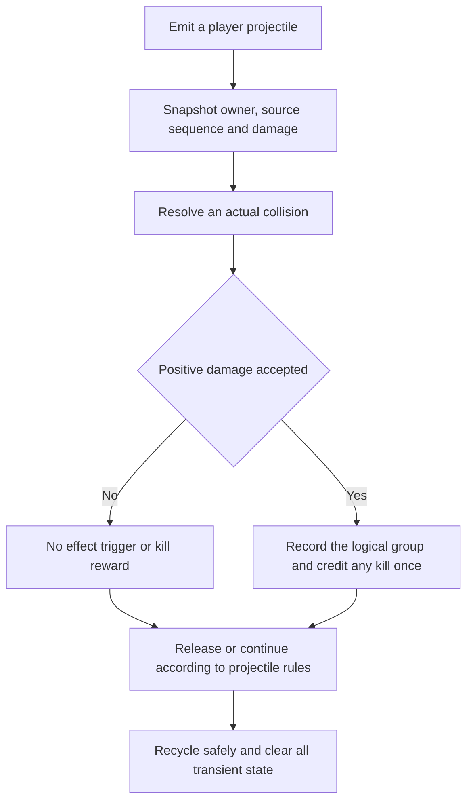
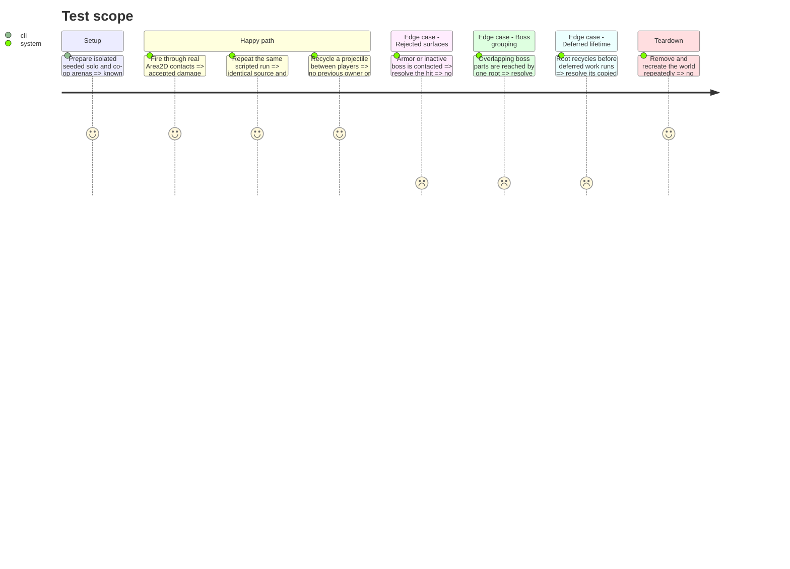

# Instruction: Establish accepted player hits, deterministic combat identities and safe projectile snapshots

The maintainer explicitly requested starting this next step on 2026-10-20 after publication. Step 5's remaining solo observations and numerical acceptance stay deferred and are not marked passed. This step introduces combat infrastructure only; the new offensive families remain inactive.

Completed 2026-10-20: [actual implementation and validation](validation/step_6_hits.md). New real-contact suite: **41 headless / 42 native checks PASS**; seeded reproducibility/lifetime suite: **1,641 checks PASS**. Focused regressions and unchanged art mappings are recorded there. Stop for review; step 7 remains pending.

## Architecture projection

> Tree of the final files. ✅ create · ✏️ modify · ❌ delete

```txt
.
├── core/run_random.gd                                      ✏️ per-player combat RNG
├── data/enemies/enemy_spawn_context.gd                     ✏️ deterministic combat identity
├── scenes/waves/wave_spawner.gd                            ✏️ assign identities without random draws
├── scenes/enemies/{enemy,mother_ship,turret}.gd             ✏️ accepted hits and child identities
├── scenes/bosses/{dread_ark,boss_hit_zone}.gd                ✏️ accepted hits and shared boss group
├── scenes/combat/player_hit_snapshot.gd                    ✅ immutable emission values
├── scenes/combat/player_hit_effects.gd                     ✅ world-owned resolution and requests
├── scenes/combat/combat_targeting.gd                       ✅ stable ordering, groups and visibility
├── scenes/combat/{projectile_pool,enemy_shot}.gd            ✏️ reset and existing reflected-hit adapter
├── scenes/player/{player,player_weapons,player_shot}.gd     ✏️ emission snapshots and lifetime cleanup
├── scenes/player/beam/continuous_beam.gd                   ✏️ accepted-hit adapter, existing behavior
├── scenes/world/{world.gd,world.tscn}                       ✏️ own the hit-effects service
├── tests/player/test_player_hit_contract.gd                ✅ real-contact and reset fixtures
├── tests/player/test_combat_reproducibility.gd             ✅ seeded trace fixtures
└── docs/phase_3_validation.md                              ✏️ append actual evidence
```

## User Journey



## Test Scope



## Tasks to do

### `1)` Introduce the accepted-hit boundary and root snapshot

> Preserve current combat while giving later effects a reliable acceptance result.

1. Follow `contract.md` combat semantics. Add `receive_player_hit` returning whether positive life loss occurred; set kill credit before delegating to the existing virtual `_hit_something` behavior.
2. Route existing gun, plasma and reflected enemy-shot damage through that boundary without adding modifiers to plasma/reflections or changing collision damage.
3. Snapshot owner ID, authored base, direct pre-critical damage, modifier ranks, critical state and source sequence at emission. Apply the common DAMAGE multiplier once, after authored gun caps; preserve the separate plasma formula.
4. Own hit resolution, root/group bookkeeping and deferred requests on the world. Group boss core/cannons by their owning boss; reject armor and invulnerable surfaces without triggers. Keep group history for the root and its reserved children, then release it when nothing remains.

### `2)` Make combat identities and random draws reproducible

> Combat effects must not perturb encounters, rewards or upgrade offers.

1. Allocate deterministic actor identities for ordinary spawns, boss reinforcements, mounted turrets and fragments; derive child identities from stable parent/child order. Never sort by instance ID or implicit group order.
2. Allocate monotonically ordered source identities per player/run and derive a combat RNG per player from the run seed without consuming any existing stream.
3. Centralize target eligibility, logical damage groups, distance/identity tie-breaking and line-of-sight queries in `CombatTargeting`. Keep this step's new offensive families inactive.

### `3)` Complete pooling and lifetime safeguards

> Neither physics callbacks nor recycled objects may leak previous-hit state.

1. Reset every snapshot, critical flag, source sequence, visited target, remaining penetration count and steering state on reuse. Preserve the existing pooled latch and deferred parking behavior.
2. Copy deferred request values before recycling their source; check world generation and owner eligibility before new emissions/procs. Reserve requested collision objects before scheduling them and add/reparent them outside callbacks.
3. Cancel queued work on world removal; stop new owner effects at DYING while allowing already flying direct shots to finish their bounded lives. Preserve pause ownership and input-reset behavior.

### `4)` Verify compatibility and the existing art mapping

> Establish evidence for later effect steps without claiming new artwork in this infrastructure delivery.

1. Exercise real collision callbacks, not only direct calls to hit methods; verify boss immunity, kill rewards, pool reuse and seeded replay. Recheck fire input, shield throwback, beam impact and boss parts/patterns.
2. Confirm the active primary/side/plasma editable-master and PNG pairs from `art_audio_inventory.md` still match their scene mappings. Do not substitute comparison atlases or alter their footprints in this step.
3. Append measured results and known baseline limitations to the validation log; stop for maintainer review.

## Test acceptance criteria

| Task | Acceptance criteria |
| ---- | ------------------- |
| 1 | Existing manual, plasma and reflected shots preserve their accepted damage and rewards; rejected hits return false and cannot trigger effects. One root cannot damage multiple surfaces of the same boss. |
| 2 | Identical seed and scripted inputs produce identical source/target traces, including child enemies; additional combat draws leave encounter, enemy, drop and offer streams unchanged. |
| 3 | Actual callback collection/recycling produces no physics-flush errors; reused shots contain only their new owner's values. Deferred work cannot read a reused source or survive its world. Root/request counts return to baseline after teardown. |
| 4 | Focused regressions retain meaningful coverage, active source/PNG mappings and screenshots show no visual migration, and the log distinguishes new evidence from known historical failures. No new offensive card is exposed yet. |
