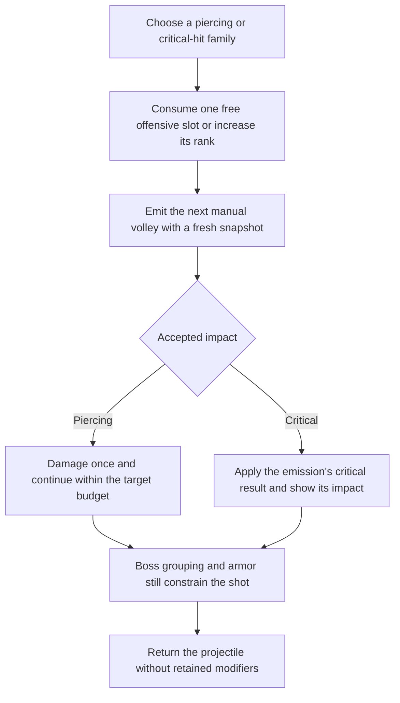
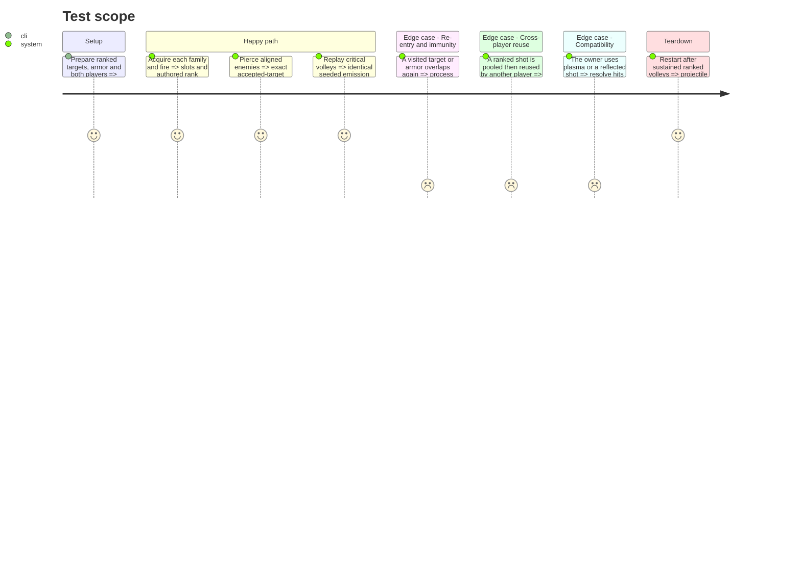

# Instruction: Add piercing and critical-hit builds with their readable weapon art

Completed locally on 2026-10-20 under the maintainer's instruction to continue after step 6. [Initial implementation, native art review and verification](validation/step_7_piercing_criticals.md): **708 native combat checks PASS**, **1,993 offer checks PASS** and focused beam/shield/fire/selection/boss regressions. Step 5 human economy acceptance remains deferred.

**Superseding playtest revision, 2026-10-21:** the maintainer found cannon penetration unsatisfying and moved it to the manual plasma beam. Live offers now contain utility `beam_piercing` and offensive `critical_hits`; the old `piercing` card is removed. Beam ranks cross 1/2/3 extra targets with +20/+30/+40% initial damage and +25/+37.5/+50% initial width. Each crossed target attenuates both by 20%; armor and boss-group exclusion remain enforced. The [beam evidence](validation/beam_piercing.md) supersedes the cannon-piercing portions of the historical instructions below. Nearest-target electric cannon chains are the next requested checkpoint, still unimplemented.

## Architecture projection

> Tree of the final files. ✅ create · ✏️ modify · ❌ delete

```txt
.
├── data/upgrades/{piercing,critical_hits}.tres              ✅ three authored ranks each
├── data/upgrades/{upgrade_definition.gd,foundation_catalog.tres} ✏️ completed-family registration
├── scenes/player/{player_loadout,player_weapons,player_shot}.gd ✏️ snapshot and penetration behavior
├── scenes/combat/{player_hit_snapshot,player_hit_effects}.gd ✏️ direct critical and accepted-group rules
├── scenes/effects/{critical_impact.gd,critical_impact.tscn}  ✅ bounded visual feedback
├── assets/sources/player/weapons/piercing_shot.aseprite     ✅ editable piercing treatment
├── assets/sprites/player/weapons/piercing_shot_sheet.{png,json} ✅ matching runtime export and mapping
├── assets/sources/effects/critical_impact.aseprite           ✅ editable critical feedback
├── assets/sprites/effects/critical_impact_sheet.{png,json}  ✅ matching runtime export and mapping
├── tests/player/test_piercing_and_critical_hits.gd          ✅ real collision and seeded critical tests
├── aidd_docs/tasks/2026_10/2026_10_19_phase_3_survival_builds/art_audio_inventory.md ✏️ mapping and review
└── docs/phase_3_validation.md                              ✏️ append actual evidence
```

## User Journey



## Test Scope



## Tasks to do

### `1)` Implement the two authored families

> Use the exact rank values and compatibility matrix in `contract.md`.

1. Add their stable IDs, rank data, icons/descriptions and slot eligibility. Register cards only after their runtime behavior is complete; use existing offer/HUD snapshots without player-node UI access.
2. Count piercing only after an accepted, previously unvisited target/group. Apply the authored decay to subsequent direct hits, stop after the allowed extra targets, and stop on armor even when damage is rejected.
3. Roll critical state once at each direct projectile emission with that owner's combat RNG. Preserve the result across all of its piercing impacts; calculate potential secondary amounts from pre-critical damage, never from doubled damage.
4. Preserve ordinary group independence and the shared boss-root exclusion; freeze behavior during pause. Stop new proc requests for a DYING owner as specified by the contract.

### `2)` Deliver and integrate effect art

> Make the two families recognizable without enlarging their damage footprints.

1. Deliver the piercing treatment and critical-impact editable sources with matching PNG/JSON exports. Update the central art inventory with team mapping, frame/tag ranges, pivots and visible/collision footprints.
2. Reuse the refreshed base lasers and approved icons; preserve red/blue ownership. Keep critical impact bounded and distinguish it from the normal hit without rescaling collision geometry.
3. Inspect native solo/co-op captures and short effect sequences; audit Lost Warden 64 exports. Do not activate `animation_rework` atlases without explicit mapping.

### `3)` Verify behavior and expose the cards

> Verify actual target contacts and seeded behavior before considering this group delivered.

1. Test each rank, combined piercing/critical shots, target re-entry, simultaneous callbacks, armor, boss parts and pool reuse across players. Compare actual accepted damage to the contract formulas.
2. Record fixed-seed critical traces with different encounter/drop/offer draw activity; verify unchanged critical traces and unchanged unrelated streams. Include forced boundary rolls rather than a statistical pass/fail threshold.
3. Validate offer uniqueness, personal slots/rank caps and meaningful fire/beam/shield regressions; append visual and runtime evidence, then stop for review.

## Test acceptance criteria

| Task | Acceptance criteria |
| ---- | ------------------- |
| 1 | Each family occupies one offensive slot regardless of rank. Actual contacts obey the three authored ranks, one accepted hit per target/group, armor blocking and boss deduplication. Critical state is constant for one emitted projectile and does not alter plasma or reflected shots. |
| 2 | Each new effect has an editable source, matching runtime export and explicit mapping. Native captures distinguish piercing/critical behavior and both owners without misleading collision size. Palette and transient lifetime checks pass. |
| 3 | Replay traces, damage assertions, real callback fixtures and inter-player pool resets pass. Only completed cards enter offers; recorded evidence includes visual inspection and identifies existing baseline limitations. |
