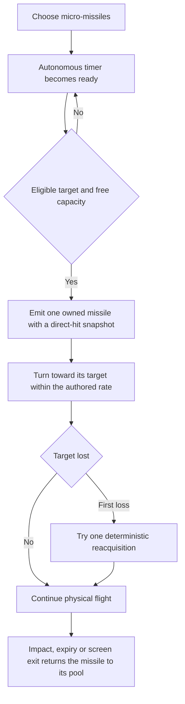
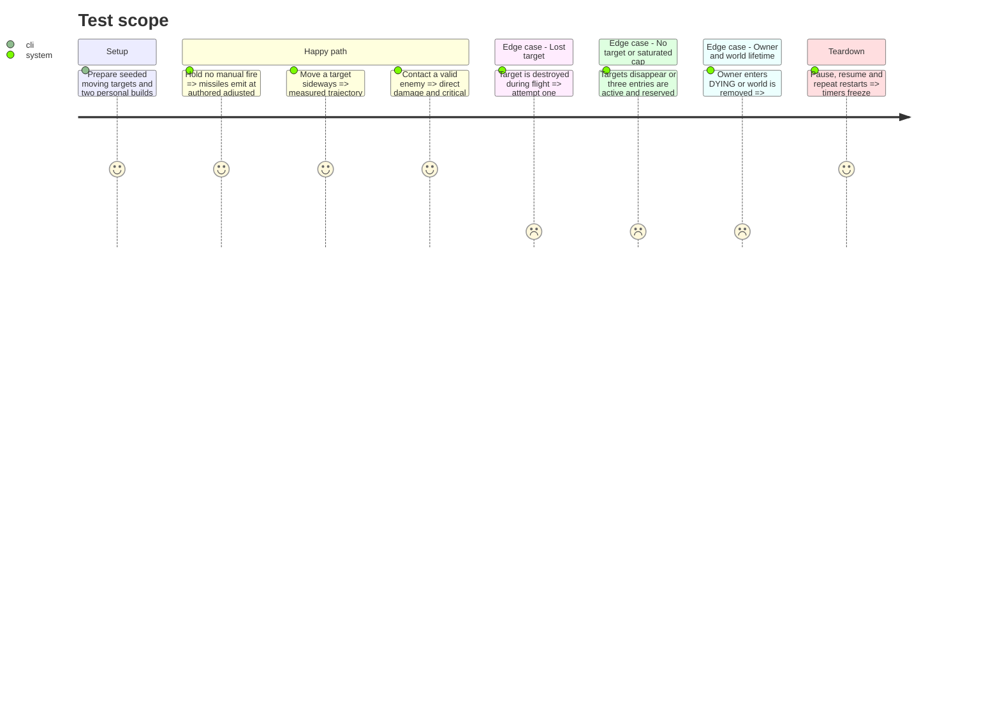

# Instruction: Add bounded homing micro-missiles and their complete sprite delivery

Delivered locally on 2026-10-21 following maintainer approval. [Implementation and evidence](validation/micro_missiles.md): **261 native missile checks**, **2,133 offer checks**, **76 native progression checks**, **132 headless chain checks**, **708 critical/legacy checks**, **111 beam-piercing checks**, **42 selection checks** and **41 accepted-hit checks PASS**. Dedicated Aseprite body/thrust/impact and owner-specific card/miniature exports pass palette/parity checks. Prototype values are retained for later balance. Stop for review before the escort drone; no commit/publication is included.

## Architecture projection

Destroyed-target follow-up: the existing retargeting is verified with a real three-missile volley: one lethal contact, then both siblings physically hit the closest forward replacement without lifetime reset or side/rear acquisition. Latest native missile fixture: **458 checks PASS**, clean shutdown. No runtime/range adjustment was required.

Forward-only follow-up: missiles now acquire, retain and reacquire targets only within the authored 90-degree screen-up cone. Side/rear targets cannot cause a launch or a U-turn. Latest verification: **447 native missile**, **423 headless missile**, **132 chain** and **2,133 offer** checks PASS; native teardown is clean. The headless missile run retains the known audio-resource shutdown warning.

Maintainer playtest revision, 2026-10-21: native small/medium/large sprites and matching independent hull collisions now accompany 1/2/3-projectile volleys. The three-active/reserved cap remains; partial volleys use only free entries. Missiles retain criticals but explicitly cannot trigger energy chains or consume their cooldown. **440 native checks**, **2,133 offer checks**, **132 chain checks** and **67 progression checks PASS** after this revision. Updated Aseprite exports and native rank comparisons supersede the original one-size/one-projectile art and chain compatibility below.

> Tree of the final files. ✅ create · ✏️ modify · ❌ delete

```txt
.
├── data/upgrades/micro_missiles.tres                        ✅ authored ranks and projectile reference
├── data/upgrades/foundation_catalog.tres                   ✏️ completed-family registration
├── scenes/player/weapons/{micro_missile.gd,micro_missile.tscn} ✅ pooled homing projectile
├── scenes/player/{player,player_weapons,player_loadout}.gd  ✏️ autonomous cadence and owner lifecycle
├── scenes/combat/{combat_targeting,player_hit_snapshot,player_hit_effects}.gd ✏️ compatible direct hits
├── scenes/combat/projectile_pool.gd                        ✏️ active/reserved lifecycle if needed
├── assets/sources/player/weapons/micro_missile.aseprite     ✅ body, thrust and impact master
├── assets/sprites/player/weapons/micro_missile_sheet.{png,json} ✅ matching runtime export and mapping
├── tests/player/test_micro_missiles.gd                     ✅ guided-flight and cap fixtures
├── aidd_docs/tasks/2026_10/2026_10_19_phase_3_survival_builds/art_audio_inventory.md ✏️ mapping and review
└── docs/phase_3_validation.md                              ✏️ append actual evidence
```

## User Journey



## Test Scope



## Tasks to do

### `1)` Add the autonomous emitter and pooled flight

> Use the missile ranks, targeting rules and fixed limits from `contract.md`.

1. Extend the existing `PlayerWeapons` update path so missile readiness advances while the living owner is not manually firing or is using plasma. No new autoload, slot type or input action is required.
2. Acquire the nearest eligible visible target from the emitter, with stable tie-breaking; retain it until invalid. On first loss, permit one acquisition within range from the missile's current position, then fly straight after failure or a later loss.
3. Enforce speed, angular turn limit and lifetime through actual flight. Collisions, including armor, resolve physically; a missile does not teleport damage to its target and has no intrinsic splash.
4. Count active plus reserved missiles per owner against the cap. No target leaves one ready emission; a saturated cap skips that opportunity without backlog. Snapshot common DAMAGE once and scale cadence by FIRE_RATE exactly as contracted.

### `2)` Integrate ownership, modifiers and artwork

> Missiles are direct sources, with complete art rather than an enemy-projectile recolor.

1. Route accepted hits through the common snapshot/effects service. Enable critical hits; keep energy chains, piercing and ricochet disabled for missiles. Preserve future explosion extension points without exposing unfinished cards.
2. Stop new emissions and procs at owner DYING; existing missiles finish their bounded lives. Cancel reserved/deferred emissions on owner/world invalidation and clear target, turn state, reacquisition latch and ownership on reuse.
3. Deliver source plus PNG/JSON for the body, propulsion and impact; update `art_audio_inventory.md` with anchors/tags and team variants. Inspect the native silhouette against both player lasers and enemy missiles; palette-check exports.

### `3)` Validate and activate the family

> Demonstrate guidance and independent co-op caps in the running physics world.

1. Test all ranks and FIRE_RATE/DAMAGE extremes, critical emission traces, no-target readiness, cap saturation, real armor/boss contacts and one-time reacquisition. Measure movement over fixed simulation steps rather than merely reading configured values.
2. Verify P1/P2 counters and snapshots independently, pause freezes guidance/cadence/lifetime, and repeated death/restart releases reservations and roots. Recheck manual fire and signature plasma behavior.
3. Enable the completed family in offers, append actual runtime/art evidence and stop for review before adding the drone.

## Test acceptance criteria

| Task | Acceptance criteria |
| ---- | ------------------- |
| 1 | Measured emission intervals, direct damage, speed, turn rate and lifetime match the contract at all ranks. Acquisition is deterministic, reacquisition happens at most once, and no owner exceeds three active/reserved missiles or receives a backlog burst. |
| 2 | Missile hits can critically strike but cannot pierce, ricochet or splash without a later applicable family. Armor and logical boss groups remain effective; pooling and deferred owner invalidation leak no state. Source/export pairs and native visual review are complete. |
| 3 | Actual-contact, flight, co-op ownership and pause/restart fixtures pass with bounded counts. The card uses personal slot eligibility and only becomes available after its implementation; manual primary/plasma behavior remains compatible. |
