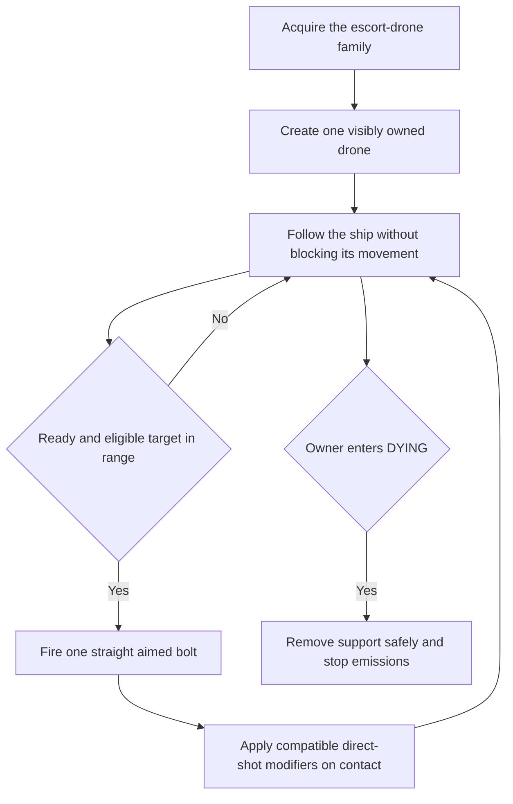
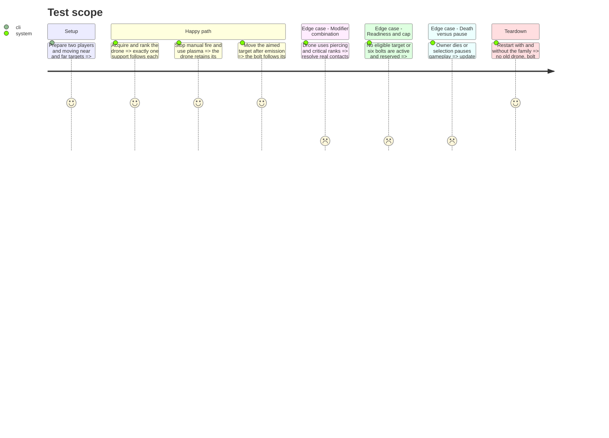

# Instruction: Add one autonomous escort drone with aimed bolts and dedicated art

## Architecture projection

> Tree of the final files. ✅ create · ✏️ modify · ❌ delete

```txt
.
├── data/upgrades/escort_drone.tres                         ✅ authored rank and weapon data
├── data/upgrades/foundation_catalog.tres                   ✏️ completed-family registration
├── scenes/player/weapons/{escort_drone.gd,escort_drone.tscn} ✅ owned support and cadence
├── scenes/player/weapons/{drone_bolt.gd,drone_bolt.tscn}    ✅ pooled straight projectile
├── scenes/player/{player_weapons,player_loadout,player_vitals}.gd ✏️ support acquisition and death cleanup
├── scenes/combat/{combat_targeting,player_hit_snapshot,player_hit_effects}.gd ✏️ shared target/hit behavior
├── assets/sources/player/weapons/{escort_drone,drone_bolt}.aseprite ✅ hull, muzzle and bolt masters
├── assets/sprites/player/weapons/{escort_drone,drone_bolt}_sheet.{png,json} ✅ matching exports and mappings
├── tests/player/test_escort_drone.gd                       ✅ ownership, aimed flight and modifiers
├── aidd_docs/tasks/2026_10/2026_10_19_phase_3_survival_builds/art_audio_inventory.md ✏️ mapping and review
└── docs/phase_3_validation.md                              ✏️ append actual evidence
```

## User Journey



## Test Scope



## Tasks to do

### `1)` Implement one following support and its straight weapon

> Use `contract.md` drone ranks and caps; do not add extra drones as rank rewards.

1. Create one owner-attached support with a fixed local shoulder anchor at `(24, -12)`; mirror the horizontal anchor for P2. Keep it non-blocking and non-intercepting, including at playfield edges; the player's existing bounds stay unchanged.
2. Acquire the nearest eligible visible target within the authored range from the drone emitter, using stable ordering. Aim once at emission and fly the bolt straight, without homing or leading the target.
3. Apply the common damage multiplier once and the specified cadence factor. Enforce six active/reserved bolts per owner and the contracted bolt lifetime. No target retains one ready shot; saturation skips without backlog.
4. Reuse the existing projectile pool, snapshot and accepted-hit rules rather than creating a separate damage implementation.

### `2)` Complete compatibility and owner lifecycle

> A drone bolt is a compatible direct cannon-like source, not an unlimited trigger chain.

1. Apply piercing and emission-time critical state to drone bolts with the same target/group and reset rules as manual guns. Keep future ricochet/explosion/chain support behind completed-family registration.
2. Let the drone fire during manual inactivity or plasma use. Pause freezes its timer and existing bolt flight without removing the support.
3. Remove the support safely and cancel new emissions/procs at owner DYING; let airborne bolts expire normally. Keep death cleanup separate from generic held-input reset so opening a choice overlay cannot destroy the drone.

### `3)` Deliver art and verify actual aimed behavior

> Ship the support, muzzle and bolt as editable/runtime pairs with readable ownership.

1. Deliver the hull/muzzle and bolt sources with PNG/JSON exports; record anchors, team variants, tags and non-blocking visual footprint in the art inventory. Keep flashes subordinate to player/enemy projectile readability.
2. Test all ranks and stat extremes through actual contacts; measure emission/flight vectors, group deduplication, caps, pause and owner death. Replay target ties and critical traces for both owners.
3. Inspect native and wide captures, including a ship at each playfield edge; palette-check exports. Register the finished card, append evidence and stop for review.

## Test acceptance criteria

| Task | Acceptance criteria |
| ---- | ------------------- |
| 1 | Each equipped living owner has exactly one non-blocking drone. Its measured cadence/damage, range, straight bolt speed and lifetime match the contract; active plus reserved bolts never exceed six and readiness never accumulates a burst. |
| 2 | Actual drone contacts obey manual-equivalent piercing/critical behavior and the common boss-group exclusion. Pause preserves frozen support state; DYING removes support safely and prevents new owned effects without deleting another player's support. |
| 3 | Editable sources, runtime exports and frame/anchor mappings are complete; native art and edge captures show distinct ownership and an unobstructed playfield. Target/critical replays and lifecycle fixtures pass before the card enters offers. |
