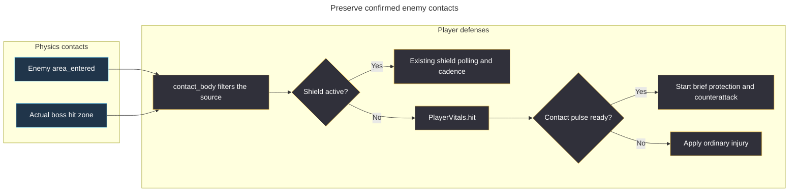

# Intermittent enemy contact loss — 2026-10-26

Historical diagnostic checkpoint. The [later role split](../2026_10_26_defense_role_split/plan.md) supersedes the shield body handling below while retaining the confirmed-contact forwarding fix.

The maintainer reported enemy/player contacts being ignored while Retaliation Pulse was ready or cooling. A moving-hull reproducer confirms the same loss without the upgrade as well.

**Root cause:** `Enemy._on_area_entered()` discarded physics-confirmed player overlaps whenever the player had a defense component. Subsequent contact polling used the player's updated position, so a short grazing overlap could have ended before that query and produce neither damage nor a ready pulse.

## Hypotheses and evidence

- [x] Protection persists during recharge — **invalidated, confidence 9/10**. A surviving overlapping drone triggers protection at 12 energy; advancing 0.61 seconds drops protection to zero and energy to 11, then another 1.01 seconds produces 10 energy while cooldown is still 10.38 seconds.
- [x] Movement causes polling to lose an overlap discarded by the callback — **validated, confidence 10/10**. Across 93 crossing scenarios, Godot reports 54 overlaps; one grazing crossing in each of `none`, `ready` and `cooldown` produces no response. The regression places a player at (280, 270), a hunter at (320, 190), and moves them at (240, 0) and (0, 300) pixels/second. Its three behavior assertions fail before the fix and pass afterward.
- [x] The pulse disables shapes or changes collision masks — **invalidated for the reproducer, confidence 9/10**. The engine still emits the actual overlap, all shield/protection values are zero in the missing unshielded/cooling contacts, and pulse code never changes player collision shapes, monitoring or masks.

The observed chain is: an overlap occurred; the callback returned without resolving it; movement changed the player's position; the later query found no overlap; no injury or countermeasure followed.

## Resolution path

Unshielded enemy callbacks and sustained-contact polling now share `PlayerDefenses.contact_body()`. The callback trusts the confirmed overlap instead of querying the moved hull again. Filters preserve the player's layer mask and reject destroyed, hidden, queued, foreign-world or mounted-turret sources. Shielded contacts retain existing radius queries and charge cadence; ordinary injury grace and pulse protection prevent duplicate callback/query responses. Boss hit zones forward their own surface so a destroyed cannon cannot be mistaken for the living parent hull.

The fix changes neither collision geometry nor the 0.6-second protection, cooldown values, contact-only trigger, shot clearing, damage or rank progression. New regressions also cover ignored masks, shield priority, duplicate shield charging and live versus broken boss surfaces. See [current validation](validation.md) for final suite results.
